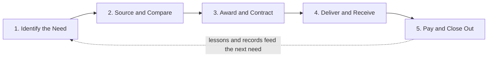

# Procurement Essentials
## Module 1: Procurement Fundamentals

**Audience:** Reps, Ops, Managers (internal)
**Lessons:** 1.1 What Procurement Is · 1.2 Who's Involved · 1.3 The Core Procurement Cycle
**Tone:** Plain language. No prior procurement knowledge assumed.

---

## Lesson 1.1: What Procurement Is (and Isn't)

> **🎯 Objective**
> By the end of this lesson you can explain what procurement is in one sentence, and tell it apart from "purchasing" and "buying."

### Chunk 1: The short version

**Procurement is the organized process an organization uses to get the goods and services it needs, from figuring out the need through paying for it.**

Every organization buys things: a coffee shop buys beans, a hospital buys MRI machines, a city buys road salt. Procurement is what separates "someone put it on a credit card" from "we have a repeatable process for deciding what to buy, from whom, at what price, and on what terms."

### Chunk 2: Procurement vs. purchasing vs. buying

These get used interchangeably in conversation, but they're different sizes of the same idea:

| Term | What it covers | Example |
|---|---|---|
| **Buying** | The act of acquiring something | Ordering 10 laptops |
| **Purchasing** | The transaction side: the order, the PO, the payment | Issuing the purchase order and paying the invoice |
| **Procurement** | The whole process, including defining the need, finding suppliers, comparing offers, negotiating, awarding, receiving, and paying | Everything from "we need laptops" to "laptops are delivered and paid for" |

> **Rule of thumb:** Buying is a moment. Purchasing is a transaction. Procurement is a process.

### Chunk 3: Why organizations bother with a process

- **Cost control:** comparing options instead of taking the first one.
- **Risk reduction:** vetting suppliers before depending on them.
- **Accountability:** a record of who decided what, and why.
- **Consistency:** the same rules apply whether the purchase is made in March or November, by one person or another.

The larger the organization, and the more it answers to others for how it spends money, the more formal this process becomes. Keep that thought; it sets up Module 2.

> **🔁 Retrieval Practice (answer before moving on)**
> 1. In your own words, what is the difference between purchasing and procurement?
> 2. Name two reasons an organization would want a formal procurement process.

> **📌 Takeaway**
> Procurement is the full process of getting what an organization needs, not just the moment of buying.

> **💬 When you're talking to a buyer**
> Buyers often use "procurement" to mean their whole function, not just placing orders. Using the word the same way signals you understand their world.

---

## Lesson 1.2: Who's Involved

> **🎯 Objective**
> By the end of this lesson you can name the main roles in a procurement and describe what each one cares about.

### Chunk 1: Two sides of every transaction

- **Buyer (the buying organization):** the party that needs something and pays for it.
- **Supplier (also called vendor, seller, or contractor):** the party that provides it.

Terminology varies. "Vendor" is common in government; "supplier" is common in private industry; "contractor" usually implies services or construction work. They overlap heavily, so expect mixed usage.

### Chunk 2: The roles inside a buying organization

Titles differ everywhere, but the *functions* are consistent:

| Function | What they do | What they care about |
|---|---|---|
| **Requester / end user** | The person or department with the need | Getting the right thing, on time |
| **Procurement / purchasing staff** | Run the process: sourcing, comparing, awarding | Following the process, value, avoiding mistakes |
| **Approver** | Authorizes spending (a manager, director, or board, depending on amount) | Budget, justification |
| **Finance / accounts payable** | Confirms funds and pays invoices | Accuracy, documentation, timing |
| **Legal / contracts** | Reviews terms for larger or riskier deals | Liability, compliance |
| **Receiving / operations** | Confirms what arrived matches what was ordered | Quality, quantity |

> **Why this matters:** In most organizations, the person who *wants* the product is not the person who *buys* it, and neither is the person who *approves* it. A deal can stall at any of these seats.

> **Varies by jurisdiction / organization:** Small organizations may have one person doing several of these jobs. Large ones split them across departments. Never assume the person you're talking to holds the decision.

### Chunk 3: The supplier side

Suppliers have their own functions: sales (finding and winning opportunities), proposal or bid staff (responding to formal requests), delivery or operations (doing the work), and billing. A supplier's goals are the mirror of the buyer's: win the work, deliver well, get paid.

> **🔁 Retrieval Practice**
> 1. A department head says "we need new software." Which procurement role is that, and are they necessarily the one who buys it?
> 2. Why might a deal stall even after the end user says yes?

> **📌 Takeaway**
> Needing, buying, approving, and paying are usually different people. Knowing who sits in each seat is half of understanding any procurement.

> **💬 When you're talking to a buyer**
> Ask who else is involved in the decision. It's a normal question and it tells you where the deal actually lives.

---

## Lesson 1.3: The Core Procurement Cycle

> **🎯 Objective**
> By the end of this lesson you can walk through the five core stages of procurement in order and explain what happens at each.

### Chunk 1: The five stages

This is the simplified, universal version. Later modules add detail (budgeting, formal solicitations, evaluation, administration), but every procurement, from a box of pens to a bridge, is some version of these five steps.

### Chunk 2: What happens at each stage

1. **Identify the need.** Someone defines *what* is needed, *how much*, *by when*, and *roughly what it should cost*. Weak definitions here cause most downstream problems.
2. **Source and compare.** The buyer finds possible suppliers and gathers prices or proposals. Depending on size and rules, this may be a quick phone call or a formal competitive process.
3. **Award and contract.** The buyer selects a supplier and formalizes the deal, through a purchase order, a contract, or both.
4. **Deliver and receive.** The supplier provides the goods or services, and the buyer confirms it matches what was agreed.
5. **Pay and close out.** The supplier invoices, the buyer pays, and records are kept. Any leftover issues (warranty, disputes, performance notes) are handled here.

> **Varies by jurisdiction / organization:** *How formal* each stage is changes with the size of the purchase and the rules the buyer must follow. A small purchase might compress stages 1 to 3 into one conversation. A large one might take months. The stages stay the same; the paperwork around them changes.

### Chunk 3: The loop

Notice the dotted line back to the start. What a buyer learns from one procurement (which suppliers performed, what things really cost) shapes the next one. Suppliers who deliver well tend to be considered again.

### Chunk 4: Glossary for this module

| Term | Meaning |
|---|---|
| **Procurement** | The full process of acquiring goods and services |
| **Purchasing** | The transactional part: ordering and paying |
| **Buyer** | The organization acquiring goods or services |
| **Supplier / Vendor / Contractor** | The party providing them |
| **Requester / End user** | The person or department with the need |
| **Purchase order (PO)** | A buyer's document authorizing a purchase from a supplier |
| **Invoice** | A supplier's bill for goods or services delivered |
| **Sourcing** | Finding and evaluating potential suppliers |
| **Award** | The buyer's decision to select a supplier |

> **🔁 Retrieval Practice**
> 1. Put these in order: Pay and close out · Identify the need · Deliver and receive · Award and contract · Source and compare.
> 2. At which stage do most downstream problems start, and why?
> 3. What stays the same across a small purchase and a large one, and what changes?

> **📌 Takeaway**
> Every procurement follows the same five stages. Size and rules change how formal each stage is, not whether it happens.

> **💬 When you're talking to a buyer**
> Knowing which stage a buyer is in tells you what they need from you right now: clarity (stage 1), comparison material (stage 2), paperwork (stage 3), and so on.

---

## 🔒 Module 1 Mastery Check

*Locked until all three lessons are complete. Suggested pass mark: 80%.*

**Q1.** Which best describes procurement?
- A. Placing an order with a supplier
- B. Paying a supplier's invoice
- **C. The full process from identifying a need through payment and close-out** ✅
- D. Comparing prices from two vendors

**Q2.** A department manager says they need new equipment and the budget is available. What can you safely assume?
- A. They will make the purchase themselves
- B. The deal is approved
- **C. Others (procurement, approvers, finance) are likely still involved** ✅
- D. They are the supplier's contact for invoices

**Q3.** "Vendor," "supplier," and "contractor" are:
- A. Completely unrelated roles
- **B. Overlapping terms for the party providing goods or services** ✅
- C. Roles inside the buying organization
- D. Terms for the approver

**Q4.** In the five-stage cycle, which stage comes immediately after "Award and contract"?
- A. Source and compare
- **B. Deliver and receive** ✅
- C. Identify the need
- D. Pay and close out

**Q5.** A small purchase and a large purchase differ mainly in:
- A. The stages they follow
- B. Whether a need exists
- **C. How formal each stage is** ✅
- D. Whether a supplier is involved

---

### Author's notes (remove before publishing)

- **Lesson 1.1 deliberately previews "public vs. private"** in one sentence only; the full treatment lives in Module 2.
- **No dollar thresholds or legal specifics appear in Module 1.** Those arrive in Modules 3 to 6 and will be verified against current sources at that time.
- **Diagram:** the Mermaid block is ready for the lesson renderer; if the platform doesn't support the `-.label.->` edge syntax, swap for a plain dotted arrow.
- **Glossary rows** are written to map directly onto `glossary_terms` for flashcards.
