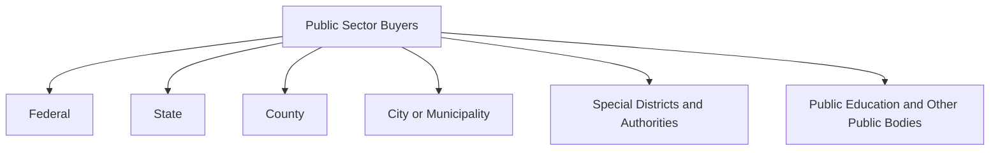
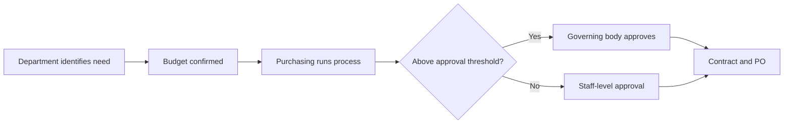

# Procurement Essentials
## Module 2: The Public Procurement Landscape

**Audience:** Reps, Ops, Managers (internal)
**Lessons:** 2.1 Public vs. Private Buying · 2.2 Who Buys in the Public Sector · 2.3 Who Decides Inside a Government Buyer
**Tone:** Plain language. Examples are generic; specifics vary by jurisdiction.

---

## Lesson 2.1: Public vs. Private Buying

> **Objective**
> By the end of this lesson you can explain why government buying works differently from private-company buying, and name the three principles that drive most of the differences.

### Chunk 1: Same cycle, different pressure

Module 1's five-stage cycle (identify the need, source and compare, award and contract, deliver and receive, pay and close out) applies to every buyer. What changes in the public sector is the pressure around each stage.

A private company spends its own money and answers to owners or investors. A public agency spends **public money**, collected from taxpayers, and answers to the public, elected officials, auditors, and the law.

### Chunk 2: The three principles

Most of the differences trace back to three ideas:

| Principle | What it means | What you'll see in practice |
|---|---|---|
| **Competition** | Suppliers get a fair chance to compete for the work | Formal solicitations, published opportunities, multiple quotes or bids |
| **Transparency** | The public can see how money is spent and why | Public notices, public bid openings, records that can be requested |
| **Accountability** | Decisions must be documented and defensible | Written criteria, scoring, approvals, audit trails |

### Chunk 3: What this changes day to day

- **Rules are written down.** Buyers follow procurement laws, codes, or policies rather than personal judgment alone.
- **The process is slower and more documented.** Steps exist so a decision can be explained later to an auditor, a board, or a losing bidder.
- **Relationships matter less than process.** A buyer may be friendly but still unable to favor one supplier. Rules about gifts, contact during a solicitation, and conflicts of interest are common.
- **Awards can be challenged.** Many jurisdictions let losing bidders protest, which is why buyers document everything.

> **Varies by jurisdiction:** The specific laws, thresholds, and formalities differ by state, county, city, and agency. The three principles hold almost everywhere.

> **Retrieval Practice**
> 1. Name the three principles behind most public-sector buying rules.
> 2. Why might a friendly public buyer still be unable to give you an inside track?

> **Takeaway**
> Public buyers use the same cycle as everyone else, but competition, transparency, and accountability shape how each stage is carried out.

> **When you're talking to a buyer**
> Expect them to talk about process, documentation, and compliance. Respecting those constraints builds trust faster than pushing for speed.

---

## Lesson 2.2: Who Buys in the Public Sector

> **Objective**
> By the end of this lesson you can name the main types of public buyers and describe how they differ in size and structure.

### Chunk 1: The levels of government

| Buyer type | What they typically buy for | Notes |
|---|---|---|
| **Federal** | National agencies and programs | Largest buyer; governed by federal rules |
| **State** | State agencies, programs, and infrastructure | Often has a central purchasing office plus agency-level buying |
| **County** | Courts, roads, public safety, health and human services | Mix of centralized and departmental purchasing |
| **City / municipality** | Public works, utilities, parks, local services | Wide range from very small to very large |
| **Special districts and authorities** | A single purpose (water, transit, ports, airports) | Often have their own boards and purchasing rules |
| **Public education and other public bodies** | School districts, colleges, universities, housing authorities | Frequently have separate rules from the city or county they sit in |

### Chunk 2: Size changes the experience

A large state agency may have a dedicated purchasing team, formal procedures, and electronic bidding. A small town may have one clerk handling purchasing alongside other duties. Same principles, very different capacity.

> **Varies by jurisdiction:** Which entities exist, how they overlap, and which rules apply to each depends on the state and locality. Never assume a school district follows the same rules as the city around it.

### Chunk 3: Why the layers matter

- Each entity is usually its **own buyer**, with its own budget, board, and rules.
- Some entities can **buy off each other's contracts** (covered in Module 3).
- Money often **flows between levels** (for example, grants from federal or state to local), and that money can come with extra requirements.

> **Retrieval Practice**
> 1. Name four types of public-sector buyers.
> 2. Why is it risky to assume a school district follows the same rules as the city it sits in?

> **Takeaway**
> The public sector is many separate buyers, each with its own budget, governing body, and rules.

> **When you're talking to a buyer**
> Start by learning what kind of entity you're talking to. It tells you who decides, how formal the process likely is, and what rules probably apply.

---

## Lesson 2.3: Who Decides Inside a Government Buyer

> **Objective**
> By the end of this lesson you can describe the typical roles inside a public buyer and how a purchase moves between them.

### Chunk 1: The roles

| Role | What they do | What they care about |
|---|---|---|
| **Department / end user** | Has the need and defines what is required | Getting something that works, on time |
| **Purchasing / procurement office** | Runs the process, enforces the rules | Compliance, fairness, documentation |
| **Contracting or legal staff** | Reviews terms and risk | Liability, enforceability |
| **Finance / budget office** | Confirms funds exist | Budget limits, proper coding of spending |
| **Governing body (council, board, commission)** | Approves larger purchases and sets policy | Public accountability, value, community impact |
| **Elected or appointed executive** | Oversees operations (mayor, county manager, superintendent, director) | Priorities, politics, results |
| **Auditors / oversight** | Review after the fact | Whether rules were followed |

### Chunk 2: How a purchase typically moves

The key idea: **the person who wants it, the person who runs the process, and the person who approves it are usually three different people**, and bigger purchases pull in more of them, often including a public meeting.

> **Varies by jurisdiction:** The dollar level at which a board or council must approve a purchase differs widely, and so does who counts as the "purchasing office." Smaller entities may combine several of these roles in one person.

### Chunk 3: Glossary for this module

| Term | Meaning |
|---|---|
| **Public sector** | Government and publicly funded bodies |
| **Public procurement** | Procurement carried out by public entities using public funds |
| **Competition** | Giving qualified suppliers a fair chance to win |
| **Transparency** | Making buying decisions open to public view |
| **Accountability** | Being able to justify and document decisions |
| **Governing body** | The council, board, or commission that sets policy and approves spending |
| **Special district / authority** | A single-purpose public entity such as water or transit |
| **Protest** | A formal challenge to an award or solicitation |
| **Public funds** | Money from taxes, fees, and public grants |

> **Retrieval Practice**
> 1. Who usually runs the buying process inside a government buyer, and who usually has the need?
> 2. What often happens to a purchase when it crosses an approval threshold?
> 3. Why are auditors included in the list of roles?

> **Takeaway**
> Public purchases move through several hands, and larger ones need approval from a governing body in public view.

> **When you're talking to a buyer**
> Ask who else needs to approve and when the governing body meets. Timing around board or council calendars often decides when a purchase can happen.

---

## Module 2 Mastery Check

*Locked until all three lessons are complete. Suggested pass mark: 80%.*

**Q1.** Which three principles drive most differences between public and private buying?
- A. Speed, price, and convenience
- **B. Competition, transparency, and accountability** (correct)
- C. Loyalty, discretion, and volume
- D. Branding, reputation, and timing

**Q2.** A friendly public buyer cannot give you an inside track mainly because:
- A. They dislike suppliers
- B. They are not allowed to speak to suppliers at all
- **C. Rules require fair competition and documented decisions** (correct)
- D. Their budget is fixed

**Q3.** Which statement about public buyers is most accurate?
- A. All government buyers follow identical rules
- **B. Each entity is usually its own buyer with its own budget, governing body, and rules** (correct)
- C. Only federal agencies run formal processes
- D. School districts always follow city rules

**Q4.** Inside a government buyer, who typically runs the buying process?
- A. The department with the need
- B. The auditors
- **C. The purchasing or procurement office** (correct)
- D. The supplier

**Q5.** What commonly happens when a purchase exceeds a set dollar level?
- A. It is automatically cancelled
- B. It skips review
- **C. It requires approval from a governing body such as a board or council** (correct)
- D. It must be sole-sourced

---

### Author's notes (remove before publishing)

- Module 2 is conceptual and contains no dollar figures or legal citations. Thresholds and codes start in Module 3 and will be verified against current sources.
- The Mermaid diagrams use plain syntax for renderer compatibility.
- Glossary rows are written to map onto `glossary_terms` for flashcards.
- Module 3 will carry the heaviest "varies by jurisdiction" load, so I'd suggest we agree on a standard callout style for it before drafting.
