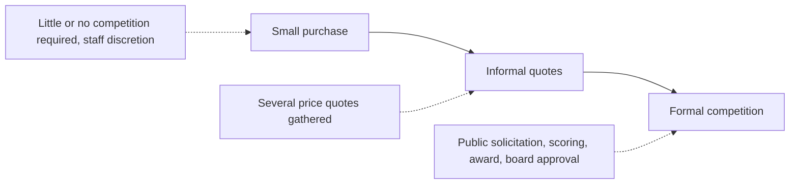

# Procurement Essentials
## Module 3: How State, County and Local Governments Buy

**Audience:** Reps, Ops, Managers (internal)
**Lessons:** 3.1 Where the Rules Come From · 3.2 Dollar Thresholds and the Tiers of Process · 3.3 Exceptions: Sole Source, Emergency and Local Programs · 3.4 Cooperative Purchasing and Piggybacking
**Note:** This is the heaviest "varies by jurisdiction" module. All dollar figures are **illustrations of how much rules differ**, not rules to quote to a buyer.

---

## Lesson 3.1: Where the Rules Come From

> **Objective**
> By the end of this lesson you can explain the layers of rules a state, county, or local buyer follows, and why you must always ask which rules apply.

### Chunk 1: Layers of rules

A public buyer's process is usually shaped by several layers at once:

| Layer | What it is | Example of what it sets |
|---|---|---|
| **State law** | Statutes passed by the legislature | Minimum competition requirements for local entities, public notice rules |
| **Local code or ordinance** | Rules adopted by a city, county, or district | Dollar tiers, approval levels, preferences |
| **Board or council policy** | Adopted policies and resolutions | Procedures, delegated authority |
| **Department procedures** | Internal guides and templates | Forms, checklists, who signs what |
| **Funding conditions** | Requirements attached to grants or special funds | Extra steps when outside money pays for the purchase |

The stricter layer usually wins. A city may be free to set its own tiers, but only inside what state law allows, and grant money can add requirements on top.

### Chunk 2: Why this matters

Two neighboring entities can buy the same item under very different rules. There is no single national rulebook for state and local buying. Public-sector buyers generally set their own tiers, dollar amounts, and approval levels.

> **Varies by jurisdiction:** Everything in this module. The right habit is to ask, not assume.

> **Retrieval Practice**
> 1. Name three layers of rules a local buyer may follow.
> 2. Why can two neighboring entities buy the same item under different rules?

> **Takeaway**
> There is no single rulebook. State law, local code, policy, and funding conditions stack, and the stricter layer governs.

> **When you're talking to a buyer**
> Ask, "What process do you follow for a purchase like this?" rather than telling them what the rules are. They know theirs, and it avoids misquoting rules that don't apply.

---

## Lesson 3.2: Dollar Thresholds and the Tiers of Process

> **Objective**
> By the end of this lesson you can describe the typical three-tier structure of public purchasing and explain why thresholds differ so much.

### Chunk 1: The typical tiers

Most public buyers scale the formality of the process to the size of the purchase:

| Tier | Typical process | Who decides |
|---|---|---|
| **Small purchase** | Often no bidding requirement; staff use judgment | Department or purchasing staff |
| **Informal / quote tier** | Staff typically gather several price quotes, sometimes with room to pick something other than the lowest price | Purchasing staff, sometimes a director |
| **Formal competition** | Published solicitation, market research, scoring, award, protest handling, and contract approval | Purchasing office plus approval by a manager, board, or council |

Formal competition is where much of the money goes. One practitioner overview says roughly 80% of local government spending falls in the formal tier, and that the process can take anywhere from several months to a couple of years. Treat both as rough context, not a promise.

### Chunk 2: How much thresholds vary

A December 2024 comparison of state small-purchase thresholds found limits ranging from about **$1,000 to $250,000** depending on the state, and the figures measure different things (direct-purchase limits, quote requirements, competition triggers), so they are not directly comparable. Illustrations from that comparison:

- One state requires only good purchasing practice below a few thousand dollars.
- Another requires no competition up to $10,000 and three quotes from $10,000 to $25,000.
- Another allows documented quotes for purchases up to $250,000.

City examples from a local-purchasing overview show the same spread, with informal ranges starting in the low thousands and, in some places, extending into six figures.

> **Varies by jurisdiction:** These are examples of the spread, not figures to repeat. Thresholds also change when laws and policies are amended, so figures like these go stale. For an actual buyer, find their current policy.

### Chunk 3: Why the tiers exist

Heavy process costs time and money for both sides. Tiers aim to match effort to risk: a few hundred dollars of supplies does not need a formal bid, while a large multi-year contract does.

> **Retrieval Practice**
> 1. What are the three typical tiers of public purchasing?
> 2. Why should you avoid quoting a specific dollar threshold to a buyer without checking their policy?
> 3. Why do the tiers exist?

> **Takeaway**
> Process scales with purchase size, but where the lines sit depends on the entity, and the lines move.

> **When you're talking to a buyer**
> Learn where the purchase sits relative to their thresholds. A buyer under the formal threshold may be able to move quickly; one above it follows a longer, public process.

---

## Lesson 3.3: Exceptions: Sole Source, Emergency and Local Programs

> **Objective**
> By the end of this lesson you can recognize the common exceptions to competition and the programs that shape who gets a chance to compete.

### Chunk 1: Common exceptions

Competition is the default, but most jurisdictions allow narrow exceptions, each with documentation requirements:

| Exception | General idea | Typical safeguard |
|---|---|---|
| **Sole source** | Only one supplier can provide what is needed (for example, proprietary products or unique services) | Written justification, sometimes public notice or higher approval |
| **Emergency** | An urgent threat to health, safety, or essential services leaves no time for the normal process | Documentation after the fact, limits on scope and duration |
| **Existing contract use** | An already-competed contract can be used (covered in Lesson 3.4) | Must be permitted by local rules |

Exceptions are meant to be rare and defensible. A buyer asking for a sole-source justification is not being difficult; they are protecting themselves from audit findings.

### Chunk 2: Programs that shape the field

Many entities run programs that influence who competes or how bids are evaluated. Examples include:

- **Small, local, or disadvantaged business programs** (for example, outreach requirements during informal bidding, or allowances for purchases from certified firms).
- **Preferences or set-asides** in some jurisdictions.
- **Funding-driven requirements** when grants or special funds pay for the purchase.

> **Varies by jurisdiction:** Whether these programs exist, who qualifies, and how they work depends entirely on the entity and, often, the funding source.

> **Retrieval Practice**
> 1. Give one reason a buyer might legitimately skip competition.
> 2. Why do buyers document exceptions so carefully?

> **Takeaway**
> Competition is the default. Exceptions exist, but they are narrow and documented, and local programs can shape who gets to compete.

> **When you're talking to a buyer**
> Never suggest a way around the process. Buyers are expected to justify any exception, and being asked to bend rules damages trust.

---

## Lesson 3.4: Cooperative Purchasing and Piggybacking

> **Objective**
> By the end of this lesson you can explain how public entities share contracts and why it matters to suppliers and buyers.

### Chunk 1: Sharing one competition

Cooperative purchasing lets public entities share a single competitive process instead of each running its own. The common forms are:

| Form | How it works |
|---|---|
| **Joint solicitation** | Several entities issue a shared bid, splitting the work and combining buying power |
| **Multiple-award schedules** | A lead agency (often a state) competitively awards contracts to several qualified suppliers; other agencies buy from those suppliers |
| **Piggybacking** | An entity uses a contract another entity already awarded competitively |

Purchasing cooperatives and regional bodies often coordinate these contracts, and suppliers commonly pay administrative fees to them. Examples of such organizations include NASPO ValuePoint, Sourcewell, and U.S. Communities.

### Chunk 2: Benefits and cautions

**Benefits**
- Saves staff time and avoids duplicate procurement.
- Combines volume for better pricing.
- Lets buyers rely on vetting already done by peers.
- Can speed access to new vendors and technologies.

**Cautions**
- Local rules still apply; entities often adapt a shared contract to their own requirements.
- Legal authority to use cooperative or other entities' contracts varies by state, so buyers check before relying on them.
- Cooperatives differ in governance and fees, so terms are reviewed.

### Chunk 3: Glossary for this module

| Term | Meaning |
|---|---|
| **Threshold** | A dollar level at which the required process changes |
| **Informal quotes** | A lighter process where staff gather several price quotes |
| **Formal competition** | A published, scored, documented competitive process |
| **Sole source** | Award to one supplier because no competition is practical |
| **Emergency purchase** | Urgent purchase with a streamlined process, documented afterward |
| **Cooperative purchasing** | Public entities sharing a competitively awarded contract |
| **Piggybacking** | Using another entity's already-competed contract |
| **Lead agency** | The entity that runs a shared solicitation |
| **Ordinance / code** | Local legal rules adopted by a city or county |
| **Delegated authority** | Approval power a governing body gives to staff up to a set level |

> **Retrieval Practice**
> 1. Name two forms of cooperative purchasing.
> 2. Why do buyers check their state's rules before piggybacking on another entity's contract?

> **Takeaway**
> Shared contracts save time for buyers, but they only work where local and state rules permit them.

> **When you're talking to a buyer**
> Ask whether they use cooperative contracts. It tells you whether their buying runs through a shared vehicle or through their own solicitations.

---

## Module 3 Mastery Check

*Locked until all four lessons are complete. Suggested pass mark: 80%.*

**Q1.** Which best describes the rules a local buyer follows?
- A. One national rulebook applies everywhere
- **B. Several layers (state law, local code, policy, funding conditions) apply, and the stricter layer governs** (correct)
- C. Only the buyer's own preference matters
- D. Only the supplier's contract terms apply

**Q2.** A rep tells a buyer, "Your threshold for formal bidding is $25,000, right?" What is the best correction?
- A. It is correct, since that is the national figure
- **B. Thresholds vary by entity, so ask what their current policy says** (correct)
- C. Thresholds do not exist for local governments
- D. Only state agencies have thresholds

**Q3.** Which pairing correctly describes typical tiers?
- A. Larger purchases need less documentation
- **B. Small purchases need little process; larger ones need formal, documented competition** (correct)
- C. All purchases follow the same process
- D. Informal quotes are used only for the largest purchases

**Q4.** What is the right response when a buyer asks for a sole-source justification?
- A. Treat it as an obstacle and push back
- B. Suggest skipping documentation
- **C. Recognize it as a normal safeguard and supply what they need** (correct)
- D. Avoid the buyer

**Q5.** What is piggybacking?
- A. Splitting a purchase into smaller pieces
- **B. Using a contract another entity already awarded competitively, where local rules allow it** (correct)
- C. Awarding to a friend of the buyer
- D. Buying without any contract

**Q6.** Which statement about cooperative contracts is most accurate?
- A. They override local procurement rules
- B. Every entity may use them in every state
- **C. They can save time, but legal authority to use them varies and local rules still apply** (correct)
- D. They are only for emergencies

---

### Author's notes (remove before publishing)

- **Figures in 3.2 are illustrative.** They come from a December 2024 state small-dollar threshold comparison (E&I) and a local purchasing overview (ELGL). The E&I document says its figures are subject to change and not guaranteed current. Before publishing, either keep them as clearly labeled examples or replace with ranges.
- **The "roughly 80%" and "months to a couple of years" figures** come from a single practitioner overview. I've kept them as hedged context; consider cutting if you want zero unsourced-to-primary statistics in trainee content.
- **Exceptions (3.3):** the sole-source and emergency descriptions reflect common patterns, but my sources did not detail them. I'd verify against at least one primary state or local code before publishing, ideally one from a state you operate in.
- **Cooperative organizations named in 3.4** (NASPO ValuePoint, Sourcewell, U.S. Communities) appear in the cited overview as examples. Confirm you want named organizations in the course.
- Mermaid diagram in 3.2 uses plain syntax; the dotted-label nodes can be dropped if the renderer struggles.

### Sources

- [ELGL: How Does Local Public Purchasing Work](https://elgl.org/how-does-local-public-purchasing-work)
- [ELGL: Cooperative Purchasing](https://elgl.org/cooperative-purchasing-the-most-prominent-buying-method-youve-never-heard-of)
- [E&I: Small Dollar Thresholds by State, December 2024](https://eandi.org/wp-content/uploads/Small-Dollar-Thresholds-by-State-December-2024.pdf)
