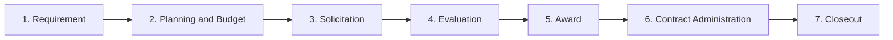

# Procurement Essentials
## Module 4: The Procurement Lifecycle

**Audience:** Reps, Ops, Managers (internal)
**Lessons:** 4.1 The Lifecycle at a Glance · 4.2 Before the Solicitation: Need, Planning and Budget · 4.3 Solicitation, Evaluation and Award · 4.4 After the Award: Administration and Closeout
**Tone:** Plain language. Examples are generic; specifics vary by jurisdiction.

---

## Lesson 4.1: The Lifecycle at a Glance

> **Objective**
> By the end of this lesson you can name the seven stages of a public procurement, and map them onto the five-stage cycle from Module 1.

### Chunk 1: From five stages to seven

Module 1 gave you the universal five-stage cycle. Public buyers break the same journey into more steps, because each step needs documentation and approval:

| Module 1 stage | Public lifecycle stages |
|---|---|
| Identify the need | 1. Requirement, 2. Planning and Budget |
| Source and compare | 3. Solicitation, 4. Evaluation |
| Award and contract | 5. Award |
| Deliver and receive | 6. Contract Administration |
| Pay and close out | 6. Contract Administration, 7. Closeout |

### Chunk 2: Three phases

It helps to group the seven stages:

- **Pre-solicitation (stages 1 to 2):** the buyer decides what it needs and whether it can pay for it. Most of a procurement's success is decided here.
- **Solicitation to award (stages 3 to 5):** the competitive part, where suppliers are invited, compared, and one is selected.
- **Post-award (stages 6 to 7):** delivery, oversight, payment, and wrapping up.

> **Varies by jurisdiction:** Names and number of stages differ. Some entities fold planning into the requirement, or treat award and contracting as separate steps. The sequence is what matters.

> **Retrieval Practice**
> 1. Which Module 1 stage covers "Source and compare" in the public lifecycle?
> 2. Which of the three phases decides most of a procurement's success?

> **Takeaway**
> The public lifecycle is the same journey as the five-stage cycle, broken into more documented steps.

> **When you're talking to a buyer**
> "Where are you in the process?" is a natural opening question. Their answer tells you what they need to hear from you.

---

## Lesson 4.2: Before the Solicitation: Need, Planning and Budget

> **Objective**
> By the end of this lesson you can describe what happens before a solicitation is published, and why the earliest stages matter most.

### Chunk 1: Requirement

Someone in a department defines the need: what is required, in what quantity, by when, to what standard. In practice this often becomes a **scope of work** (for services) or **specifications** (for goods).

A weak requirement is the most common source of later trouble. Vague scope leads to mismatched bids, change orders, or disputes.

### Chunk 2: Planning and budget

Before spending, the buyer works out:

- **Is the money there?** Funds must be budgeted or otherwise available, and they may be tied to a grant or a specific fund.
- **How much is it likely to cost?** Estimates (sometimes called an independent cost estimate) help place the purchase in the right tier and judge bids later.
- **What method fits?** The estimated value and the type of need guide whether it is a quote process or a formal competition (Module 3).
- **Who needs to approve?** Higher-value purchases may need sign-off before going out.
- **Is there an existing vehicle?** A cooperative or existing contract might make a new solicitation unnecessary.

### Chunk 3: Why this stage is quiet and powerful

Suppliers usually do not see these stages. Yet many outcomes are shaped here: how the scope is written, which method is chosen, what the budget allows.

> **Varies by jurisdiction:** Budget cycles, planning requirements, and approval steps differ widely. Many entities budget annually, so timing of a purchase often follows the fiscal calendar.

> **Retrieval Practice**
> 1. What is a scope of work?
> 2. Name two things a buyer works out before issuing a solicitation.
> 3. Why do many outcomes get decided before suppliers see anything?

> **Takeaway**
> Need and planning shape everything downstream. A clear requirement and confirmed funding are the foundation of a clean procurement.

> **When you're talking to a buyer**
> The earlier you understand their need and timing, the more useful you can be. Learn their budget cycle; it often explains why timing looks the way it does.

---

## Lesson 4.3: Solicitation, Evaluation and Award

> **Objective**
> By the end of this lesson you can explain how a public buyer invites, compares, and selects suppliers, and why the process is documented the way it is.

### Chunk 1: Solicitation

The buyer publishes a request that tells suppliers what is needed and how to respond. A solicitation typically includes:

- The scope or specifications
- Instructions for responding and the deadline
- Evaluation criteria (how responses will be judged)
- Required forms and terms
- A contact for questions and rules on communication during the process

Public notice is common so suppliers have a fair chance to see it. Many buyers allow questions and may answer them for everyone (often through an addendum) so no one has an informational edge.

(Module 5 covers the types of solicitations in detail.)

### Chunk 2: Evaluation

After the deadline, responses are reviewed:

1. **Compliance check:** Did the supplier follow the instructions and submit what was required?
2. **Evaluation against the stated criteria:** Price alone in some processes; price plus quality, experience, and approach in others.
3. **Documentation:** Scoring and notes are kept so the decision can be explained later.

The principle: **buyers evaluate against the criteria they published, not new ones.**

### Chunk 3: Award

The buyer selects the supplier according to the process. Depending on size and rules, award may need approval from a manager, board, or council, and may be announced publicly. After award, the buyer and supplier finalize the contract.

Unsuccessful suppliers may be able to request a debrief or file a protest, depending on local rules, which is another reason the paper trail matters.

> **Varies by jurisdiction:** Rules for communication during a solicitation, public bid openings, debriefs, protest windows, and award announcements differ by entity.

> **Retrieval Practice**
> 1. Why do buyers often answer supplier questions for everyone, not just the person who asked?
> 2. What do buyers evaluate responses against?
> 3. Name two reasons buyers document evaluation so carefully.

> **Takeaway**
> Solicitation, evaluation, and award are the visible competitive core. Fairness and documentation drive how each step is run.

> **When you're talking to a buyer**
> During an open solicitation, follow their communication rules strictly. Contact outside the designated channel can disqualify a supplier or taint the process.

---

## Lesson 4.4: After the Award: Administration and Closeout

> **Objective**
> By the end of this lesson you can describe what happens after a contract is awarded and why this stage matters to both sides.

### Chunk 1: Contract administration

Awarding the contract is not the end. Someone must make sure the agreement is carried out:

- **Monitoring performance** against the contract terms and deliverables
- **Managing changes**, which are usually made through formal modifications or amendments
- **Reviewing and approving invoices**, then paying
- **Handling issues** such as delays, quality problems, or disputes
- **Tracking dates** such as renewals and expirations

The buyer's contract administrator or project manager is often a different person from the one who ran the solicitation.

### Chunk 2: Closeout

When the work or term is complete:

- Final deliverables are accepted
- Final invoices are paid and any retained amounts released
- Records are filed and retained as required
- Performance may be documented

Records often have to be kept for a set period, because audits and public records requests can come years later.

### Chunk 3: The loop back

How a supplier performs becomes part of the buyer's experience, and in some places part of a formal record. That experience shapes future procurements. The lifecycle is a loop, just like the cycle in Module 1.

### Chunk 4: Glossary for this module

| Term | Meaning |
|---|---|
| **Requirement** | The defined need a purchase must satisfy |
| **Scope of work** | Description of services and deliverables |
| **Specifications** | Description of goods or technical standards |
| **Solicitation** | The published request inviting supplier responses |
| **Addendum** | A written change or clarification issued to all suppliers |
| **Evaluation criteria** | The published factors used to judge responses |
| **Award** | Selection of the supplier |
| **Contract administration** | Overseeing performance after award |
| **Modification / amendment** | A formal change to a contract |
| **Closeout** | Completing and documenting the end of a contract |
| **Fiscal year** | The 12-month budgeting period an entity uses |

> **Retrieval Practice**
> 1. Why is contract administration often handled by a different person than the one who ran the solicitation?
> 2. What is a modification?
> 3. Why are records kept after closeout?

> **Takeaway**
> The work isn't over at award. Administration and closeout determine whether the contract delivers, and they feed the buyer's next decision.

> **When you're talking to a buyer**
> Many buyers care as much about what happens after award as before it. Knowing how they track performance and invoicing shows you understand their full lifecycle.

---

## Module 4 Mastery Check

*Locked until all four lessons are complete. Suggested pass mark: 80%.*

**Q1.** Which phase of the public lifecycle largely determines a procurement's success?
- **A. Pre-solicitation (requirement and planning)** (correct)
- B. Closeout
- C. Invoicing
- D. Protest

**Q2.** Which pairing is correct?
- A. Requirement: selecting the winner
- **B. Evaluation: judging responses against published criteria** (correct)
- C. Closeout: writing the scope of work
- D. Planning: issuing invoices

**Q3.** Why do buyers often share answers to supplier questions with everyone?
- A. To save time
- **B. So no supplier has an informational advantage** (correct)
- C. To avoid writing the solicitation
- D. To skip evaluation

**Q4.** During an open solicitation, the best practice is to:
- A. Contact the department head directly to learn more
- **B. Use only the communication channel the buyer designates** (correct)
- C. Ask the end user for the evaluation scores
- D. Wait until after award to ask questions

**Q5.** A formal change to an existing contract is called a:
- A. Solicitation
- B. Award
- **C. Modification or amendment** (correct)
- D. Closeout

**Q6.** Why do buyers retain records after closeout?
- A. To avoid paying invoices
- **B. Audits and public records requests can come years later** (correct)
- C. To pick suppliers at random
- D. Records are never kept

---

### Author's notes (remove before publishing)

- Module 4 is conceptual and contains no dollar figures or legal citations. Stage names reflect common usage; a few entities label them differently, which the "varies" callout covers.
- Module 5 will detail solicitation types (RFQ, RFP, IFB/ITB, RFI) that Lesson 4.3 only references.
- The loop-back idea in 4.4 intentionally echoes Module 1.3 for continuity.
- Glossary rows map onto `glossary_terms` for flashcards.
