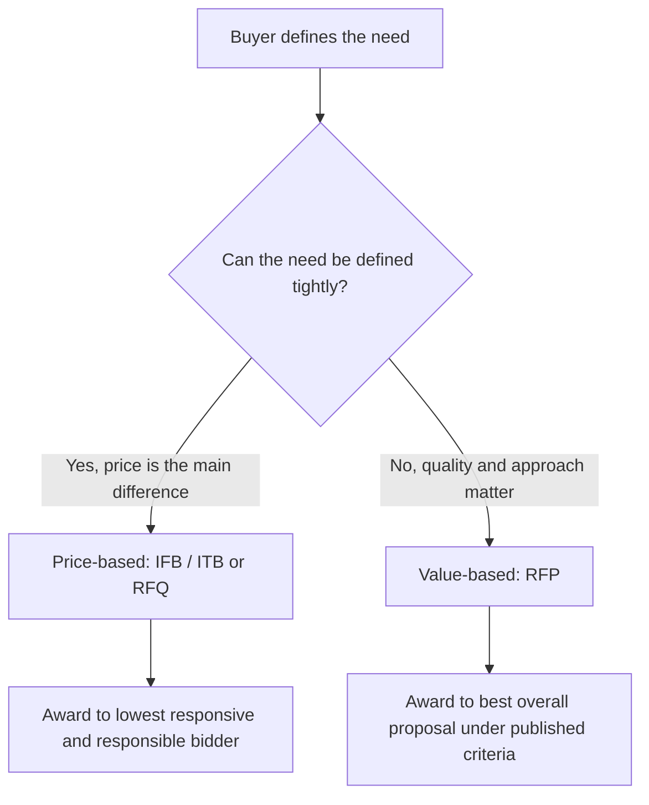

# Procurement Essentials
## Module 5: Solicitations, Contracts and Purchasing Vehicles

**Audience:** Reps, Ops, Managers (internal)
**Lessons:** 5.1 Solicitation Types · 5.2 Choosing Between Price and Value · 5.3 Contract Types: Who Carries the Cost Risk · 5.4 Purchasing Vehicles: Master Agreements and Indefinite-Quantity Contracts
**Tone:** Plain language. Terminology varies by entity; this module teaches the common meanings and how to check.

---

## Lesson 5.1: Solicitation Types

> **Objective**
> By the end of this lesson you can define the common solicitation types (RFI, RFQ, IFB/ITB, RFP) and recognize when each is typically used.

### Chunk 1: The alphabet soup

Public buyers use different documents for different situations. The names below are the common ones:

| Type | Stands for | Typical use |
|---|---|---|
| **RFI** | Request for Information | Gathers information about the market or options before a purchase. It does not buy anything |
| **RFQ** | Request for Quotation (or Quotes) | Clearly defined needs where price is the main difference; often faster and lighter |
| **IFB / ITB** | Invitation for Bid / Invitation to Bid | Tightly defined specifications; award typically goes to the lowest responsive and responsible bidder |
| **RFP** | Request for Proposal | Needs where more than price matters (experience, approach, service levels); award weighs these factors with cost |

### Chunk 2: Words that trip people up

- **"Responsive"** means the bid followed the instructions and met the requirements. **"Responsible"** means the bidder is capable of performing (for example, qualified and financially sound). A low bid that is not responsive or not responsible can be rejected.
- **RFQ has two meanings.** It can mean Request for **Quotes** (price-based, often informal) or Request for **Qualifications** (selecting a firm based on qualifications, used in some places for design and engineering services). Always check the document.
- **IFB and ITB** are used interchangeably in many places.

### Chunk 3: The name does not control

A document's title matters less than the process the law or policy requires for that kind of purchase. A solicitation called one thing may be required to follow another process. If grant funding is involved, the grant's requirements also apply.

> **Varies by jurisdiction:** Which type a buyer may use for which purchase is usually set by state law or local policy. Some entities use lighter hybrids (sometimes called "RFP lite"), and the same term can carry different requirements in different places.

> **Retrieval Practice**
> 1. Which solicitation type does not buy anything?
> 2. What is the difference between "responsive" and "responsible"?
> 3. Name the two meanings of RFQ.

> **Takeaway**
> RFI informs, RFQ prices, IFB/ITB awards on low bid, and RFP weighs value. Terms vary, so read the document, not just the title.

> **When you're talking to a buyer**
> When a buyer says "we're putting out an RFQ," ask what they mean by it. It takes ten seconds and prevents you from preparing the wrong kind of response.

---

## Lesson 5.2: Choosing Between Price and Value

> **Objective**
> By the end of this lesson you can explain why a buyer picks a price-based or value-based method, and what that means for how a response is judged.

### Chunk 1: Two award logics

| | Price-based (IFB/ITB, RFQ) | Value-based (RFP) |
|---|---|---|
| **Best when** | Specifications are precise; goods are standard | Needs are complex; approach and experience matter |
| **How award is decided** | Lowest price among those who qualify | Published criteria weighing price with other factors |
| **Negotiation** | Typically limited or none | Often allowed in some form, depending on rules |
| **Effort for both sides** | Lower | Higher |

### Chunk 2: A common mistake

Teams often misread "lowest bid" rules. In a price-based process, the buyer generally cannot choose a more expensive bidder because they like them better. In a value-based process, the lowest price does not automatically win, but only the published criteria can be used to decide.

### Chunk 3: Why the choice of method is not about dollar size

The choice usually depends on complexity, how much quality matters, and how much flexibility the buyer needs, not simply how much money is involved. (Dollar thresholds in Module 3 decide how formal the process must be, not which philosophy it uses.)

> **Varies by jurisdiction:** Some jurisdictions require price-based bidding for certain purchases (for example, standard supplies or construction above a set amount) and allow value-based methods only for specific categories such as technology or professional services.

> **Retrieval Practice**
> 1. When is a price-based method most appropriate?
> 2. In a value-based process, what are the only factors a buyer can use to decide?
> 3. Does the dollar amount alone decide whether a buyer uses an IFB or an RFP?

> **Takeaway**
> Price-based methods reward the lowest qualified price. Value-based methods reward the best overall proposal under the published criteria.

> **When you're talking to a buyer**
> Understanding which logic they're using tells you what they care about: precision and price, or approach and experience.

---

## Lesson 5.3: Contract Types: Who Carries the Cost Risk

> **Objective**
> By the end of this lesson you can describe the main ways contracts set price and explain who carries the risk of cost overruns under each.

### Chunk 1: The core idea

Contract types differ mostly in one question: **if the work costs more or less than expected, who feels it?**

| Type | How price works | Who carries cost risk |
|---|---|---|
| **Fixed price** | One agreed price for defined work | The supplier |
| **Fixed price with incentives** | Target price with adjustments for performance or cost outcomes, often with a ceiling | Shared |
| **Time and materials (T&M)** | Buyer pays set hourly rates for labor plus the cost of materials, usually up to a limit | Mostly the buyer, with a cap as protection |
| **Cost-reimbursement** | Buyer reimburses allowed costs plus a fee, usually up to an estimate | Mostly the buyer |
| **Unit price** | A set price per unit (per item, per hour, per ton), with total depending on quantity ordered | Depends on volume |

### Chunk 2: Why a buyer picks one

- **Fixed price** fits well-defined work where the supplier can estimate costs reliably. It is common in sealed-bid, price-based processes.
- **T&M and cost-reimbursement** fit work that is hard to define in advance. They need more oversight because the final cost isn't known up front.
- **Incentive structures** try to reward efficiency or performance by tying fees or profit to outcomes.

### Chunk 3: Where you'll see them

At the state and local level, fixed-price and unit-price arrangements are very common. Cost-reimbursement structures show up more in the federal world and in specialized work, so treat the federal-style variations (cost-plus-fixed-fee, award-fee, and similar) as awareness, not daily vocabulary.

> **Varies by jurisdiction:** Some entities restrict certain contract types, for example limiting cost-based pricing, or require extra approval for open-ended arrangements.

> **Retrieval Practice**
> 1. Under a fixed-price contract, who carries cost-overrun risk?
> 2. Why do T&M contracts usually include a cap?
> 3. Why would a buyer choose a unit-price contract?

> **Takeaway**
> Contract types allocate cost risk. The tighter the scope, the more a buyer can push risk to the supplier with a fixed price.

> **When you're talking to a buyer**
> Listening to which pricing structure a buyer prefers reveals how confident they are in their scope and how they want to manage risk.

---

## Lesson 5.4: Purchasing Vehicles: Master Agreements and Indefinite-Quantity Contracts

> **Objective**
> By the end of this lesson you can explain what a purchasing vehicle is and how buyers use agreements that are competed once and used many times.

### Chunk 1: One competition, many purchases

A **purchasing vehicle** is an agreement set up so the buyer can make repeated purchases without running a full competition each time. Common forms:

| Vehicle | General idea |
|---|---|
| **Master agreement / price agreement** | Pre-negotiated terms and prices with one or more suppliers; buyers order as needed |
| **On-call / as-needed contract** | A supplier is available to be called when a need arises (common for recurring services) |
| **Indefinite-quantity (IDIQ-style) contract** | A contract for an unspecified quantity within stated limits and a fixed period; specific work is ordered through task or delivery orders |
| **Blanket purchase agreement (BPA)** | A simplified arrangement for repeat purchases of similar items |
| **Cooperative contract** | A contract competed by another entity that others may use (Module 3) |

### Chunk 2: How indefinite-quantity contracts work

Using the federal definition as the model:

- The contract covers an **indefinite quantity** of goods or services within **stated limits** over a **fixed period**, often a base period with optional extension years.
- A **minimum guarantee** commits the buyer to purchase at least a set amount.
- **Task orders** (services) and **delivery orders** (supplies) are placed as needs arise. The price and detail are fixed when each order is placed.
- **Single award:** one supplier holds the contract. Simpler, but the buyer can become locked in to that vendor.
- **Multiple award:** several qualified suppliers hold contracts, and each order is competed among them. Generally favored for keeping competition alive.

### Chunk 3: Why it matters to suppliers

Winning a vehicle often means getting on a list, not receiving any guaranteed work. Revenue depends on orders actually being placed, and in multiple-award vehicles, on winning them.

### Chunk 4: Glossary for this module

| Term | Meaning |
|---|---|
| **RFI** | Request for Information; gathers market information |
| **RFQ** | Request for Quotes (price-based) or Request for Qualifications (qualification-based), depending on the entity |
| **IFB / ITB** | Invitation for Bid / to Bid; award to lowest responsive, responsible bidder |
| **RFP** | Request for Proposal; award on best overall value |
| **Responsive** | A bid that follows instructions and meets requirements |
| **Responsible** | A bidder capable of performing the work |
| **Fixed price** | Set price regardless of actual cost |
| **Time and materials** | Hourly labor rates plus materials, typically capped |
| **Cost-reimbursement** | Buyer reimburses allowed costs plus a fee |
| **Unit price** | Set price per unit; total depends on quantity |
| **Master / price agreement** | Pre-negotiated terms for repeated orders |
| **On-call contract** | Supplier available as needs arise |
| **IDIQ** | Indefinite delivery, indefinite quantity contract |
| **Task / delivery order** | A specific order placed under an indefinite-quantity contract |
| **Single / multiple award** | One supplier vs. several qualified suppliers on a vehicle |

> **Retrieval Practice**
> 1. What is the main supplier risk of winning a place on a vehicle?
> 2. What is the difference between a task order and a delivery order?
> 3. Why do many buyers prefer multiple-award vehicles?

> **Takeaway**
> A vehicle is a competed-once, used-many-times agreement. Being on one creates opportunity, not guaranteed revenue.

> **When you're talking to a buyer**
> Ask whether the purchase will run through an existing vehicle. If it will, the competition may already be over, and the conversation is about how to get on or use that vehicle.

---

## Module 5 Mastery Check

*Locked until all four lessons are complete. Suggested pass mark: 80%.*

**Q1.** Which solicitation type is used only to gather information and does not buy anything?
- A. IFB
- B. RFQ
- **C. RFI** (correct)
- D. RFP

**Q2.** An IFB/ITB is typically awarded to:
- A. The bidder with the best presentation
- B. The most experienced firm
- **C. The lowest responsive and responsible bidder** (correct)
- D. The first bidder to respond

**Q3.** What does "responsible" mean for a bidder?
- A. They submitted early
- B. They followed the format
- **C. They are capable of performing the work** (correct)
- D. They are the lowest priced

**Q4.** Under a firm fixed-price contract, who carries the risk of cost overruns?
- A. The buyer
- **B. The supplier** (correct)
- C. The auditor
- D. Shared equally by default

**Q5.** Why do T&M contracts usually include a cap?
- A. To make them cheaper for the supplier
- **B. To protect the buyer from open-ended cost** (correct)
- C. To eliminate hourly rates
- D. To avoid documentation

**Q6.** In an indefinite-quantity contract, how is a specific need fulfilled?
- A. Through a new solicitation each time
- **B. Through task or delivery orders placed under the contract** (correct)
- C. Through a sole-source award
- D. Through a protest

**Q7.** What does winning a place on a purchasing vehicle usually guarantee?
- A. A fixed amount of revenue
- B. Exclusive rights to all orders
- **C. The opportunity to receive orders, not guaranteed work** (correct)
- D. Immunity from competition

---

### Author's notes (remove before publishing)

- **Source basis.** Solicitation definitions follow a UNC School of Government overview (North Carolina focus) and an E&I overview of solicitation types. Contract-type pricing logic follows a federal-focused summary. IDIQ mechanics follow a Congressional Research Service In Focus (federal, updated Nov. 12, 2024). Both federal sources are used as models, and the lessons say so.
- **Time and materials.** The source I pulled did not explain T&M, so that row reflects the common definition (hourly rates plus materials, usually capped). Worth verifying against a primary source before publishing.
- **Unit price and BPA rows** are also standard definitions not drawn from a fetched source.
- **State/local exceptions.** The "RFQ means qualifications" point comes from one state's practice (North Carolina). It is flagged as varying, but confirm how the states you operate in use the term.
- **No dollar thresholds** appear in this module by design; they live in Module 3.
- Glossary rows map onto `glossary_terms` for flashcards.

### Sources

- [UNC School of Government: The ABCs of IFBs, ITBs, RFPs, RFQs, and RFIs](https://canons.sog.unc.edu/the-abcs-of-ifbs-itbs-rfps-rfqs-and-rfis/)
- [E&I: Types of Solicitation Documents in Procurement](https://www.eandi.org/resources/ei-blog/types-of-solicitation-documents-procurement/)
- [CRS: Indefinite Delivery, Indefinite Quantity Contracts (IF12558)](https://www.everycrsreport.com/reports/IF12558.html)
- [Contract types explained (CBH)](https://www.cbh.com/insights/articles/far-government-contract-types-explained/)
