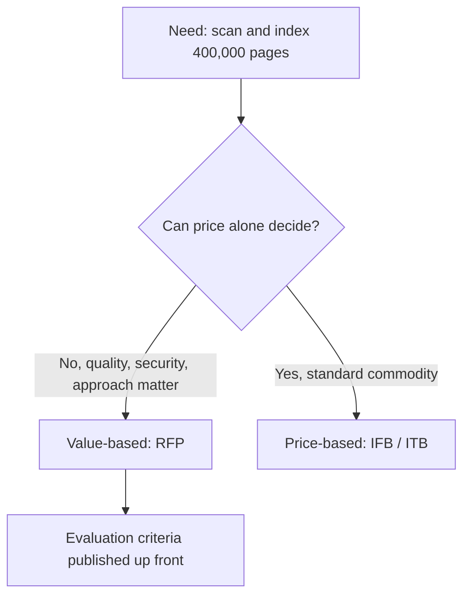

# Procurement Essentials
## Module 8: End-to-End Walkthrough

**Audience:** Reps, Ops, Managers (internal)
**Lessons:** 8.1 The Scenario: Need, Planning and Method · 8.2 Solicitation, Evaluation and Award · 8.3 Delivery, Closeout and the Federal Contrast
**Tone:** Plain language. This module is a story that ties Modules 1 to 7 together.
**Important:** The city, people, dollar figures, thresholds, scoring weights and dates below are **fictional and illustrative**. They show how the pieces fit, not what any real entity does. Real entities set their own rules (Module 3).

---

## Lesson 8.1: The Scenario: Need, Planning and Method

> **Objective**
> By the end of this lesson you can follow a purchase from the first identified need through the choice of method, and name which earlier module each step comes from.

### Chunk 1: Meet the buyer

**The City of Maple Ridge** (fictional) is a mid-sized city with a purchasing office, a city manager, and a city council that meets twice a month. Its Records Department has thousands of boxes of paper permits and property files, and staff keep getting public records requests (Module 6.3) that take days to fulfill because the files are on paper.

### Chunk 2: Stage 1, Requirement (Modules 1 and 4)

The Records Director defines the need: **scan, index, and securely store about 400,000 pages, with searchable results and a way to retrieve files within one business day.** She writes a **scope of work** with a delivery timeline of roughly nine months and a requirement that the supplier handle the paper securely and return or destroy it as directed.

> **Why it matters:** This is the "quiet and powerful" stage (Module 4.2). The clearer this scope is, the cleaner everything after it will be.

### Chunk 3: Stage 2, Planning and budget (Module 4)

- **Funding:** The department confirms $200,000 in its adopted budget for the fiscal year (fictional).
- **Estimate:** Staff gather reference pricing and estimate about **$180,000**.
- **Existing vehicles:** Purchasing checks whether a cooperative or existing contract could be used (Module 3.4). None fits the city's security requirements, so a new solicitation is needed.
- **Method:** The city's policy (fictional) says purchases above **$75,000** require formal competition and council approval above **$150,000**. At about $180,000, this purchase needs both.

### Chunk 4: Choosing the method (Module 5)

Quality, security practices, and experience matter as much as price here, so purchasing chooses a **Request for Proposals (RFP)** rather than a lowest-price bid. The planned contract structure is **unit price per page** for scanning plus a **fixed price** for setup and indexing (Module 5.3).

> **Retrieval Practice**
> 1. Which stage is the "quiet and powerful" one, and what is produced there?
> 2. Why did the buyer use an RFP rather than an IFB?
> 3. What two thresholds applied to this purchase, and what does each trigger?

> **Takeaway**
> By the time anything is published, the need, funding, method, and approvals path have been decided. A supplier's chance to shape the outcome is small once the solicitation is public.

> **When you're talking to a buyer**
> The earlier you understand their need, timing, and budget cycle, the more useful you can be, always within their contact rules.

---

## Lesson 8.2: Solicitation, Evaluation and Award

> **Objective**
> By the end of this lesson you can describe what happens from publication of a solicitation through council approval, and what a supplier should and should not do at each step.

### Chunk 1: Solicitation (Modules 4.3 and 6.1)

Maple Ridge publishes the RFP on its bid portal and in a public notice. It includes:

- The scope of work and required security practices
- A **question deadline** and a single contact for questions
- A **no-contact rule** (Module 6.1): suppliers may communicate only with the named purchasing contact until award is announced
- A proposal deadline
- The **evaluation criteria and weights** (fictional): technical approach 30%, security and data handling 25%, relevant experience 20%, price 25%
- Notice that proposals become public records after award, with instructions for marking genuine trade secrets (Module 6.3)

A supplier asks a question about scanning formats. The city answers it in a written **addendum** sent to everyone who downloaded the RFP, not only the asker (Module 6.1).

### Chunk 2: What a supplier does here

- Reads the entire RFP and follows the instructions exactly (responsive, Module 5.1)
- Sends questions only through the designated channel before the deadline
- Writes assuming competitors will later read the proposal
- Marks only genuine trade secrets, as instructed
- Does **not** call the Records Director, the city manager, or council members

### Chunk 3: Evaluation (Module 4.3)

Five proposals arrive.

1. **Compliance check:** One is rejected as non-responsive for missing a required form.
2. **Evaluator disclosures:** Each evaluator signs a conflict-of-interest disclosure. One evaluator discloses that her brother-in-law works for a bidder and is replaced (Module 6.2).
3. **Scoring:** Evaluators score the four remaining proposals against the published criteria only, and document their notes.
4. **Ranking:** A bidder with the lowest price ranks third overall because of weaker security and experience scores. Under an RFP, lowest price does not automatically win (Module 5.2).

### Chunk 4: Award (Modules 4.3 and 3.1)

The top-ranked proposal is about $176,000, which exceeds the council approval level. Purchasing places a recommendation on the council agenda. At a public meeting, the council approves the award. The city notifies all bidders and, depending on its rules, offers debriefs.

### Chunk 5: A protest sidebar (Module 6.4)

The third-ranked bidder believes the winner's scoring was unfair and files a protest within the city's deadline (fictional: a few business days). The city's purchasing director reviews it. Because evaluators scored strictly against the published criteria and documented everything, the protest is denied. The paper trail is the reason the process held up.

> **Retrieval Practice**
> 1. Why did the city send its answer to the supplier's question to everyone?
> 2. What happened to the evaluator with a family tie to a bidder?
> 3. Why did a documented process help the city when a protest was filed?

> **Takeaway**
> Fair process shows up everywhere: equal information, disclosed conflicts, scoring against published criteria, a public approval, and records that can be defended.

> **When you're talking to a buyer**
> During an open solicitation, we communicate only through the designated channel. Outside it, relationships can be built before the solicitation opens, never during.

---

## Lesson 8.3: Delivery, Closeout and the Federal Contrast

> **Objective**
> By the end of this lesson you can describe what happens after award, and explain in two or three sentences how the same purchase would differ at the federal level.

### Chunk 1: Contract and administration (Module 4.4)

- The city and supplier finalize the **contract**, including terms, security requirements, and pricing (unit price per page plus fixed setup).
- A **contract administrator** in the Records Department (a different person from the purchasing officer who ran the RFP) monitors progress.
- Halfway through, the city adds 40,000 more pages. This is handled through a **formal modification** to the contract, not a handshake (Module 4.4).
- The supplier submits **invoices**, which the city reviews against delivered work before paying.

### Chunk 2: Closeout (Module 4.4)

- The city accepts the final deliverables and checks that the paper has been returned or destroyed as required.
- Final invoice is paid; any retained amount is released.
- Records are filed and retained, since audits and records requests can come years later.
- The supplier's performance is noted, and it will influence how the city views them in future procurements. The loop in Module 1 closes.

### Chunk 3: The same purchase at the federal level (Module 7)

If a federal agency bought a similar service:

- It would follow the **FAR** instead of a local ordinance, with agency supplements.
- The opportunity would most likely be posted on **SAM.gov**, and the supplier would need an active registration to receive an award.
- The agency might use an existing **contract vehicle** (for example, a GSA schedule) instead of running a new competition.
- Federal **small business set-aside rules** (such as the Rule of Two) could limit who may compete.
- Thresholds such as the **simplified acquisition threshold** would determine how formal the process must be, and those thresholds are federal, not city, figures.

The stages, the principles, and the importance of documentation are the same. The rulebook, portal, and scale are different.

### Chunk 4: The whole journey on one page

| Stage | What happened in Maple Ridge | Module |
|---|---|---|
| Requirement | Records Director wrote a scope of work | 1, 4 |
| Planning and budget | Funding confirmed, estimate built, method chosen | 3, 4 |
| Solicitation | RFP published with criteria and no-contact rule | 4, 5, 6 |
| Evaluation | Compliance check, disclosures, documented scoring | 4, 6 |
| Award | Council approved in public | 2, 3 |
| Protest | Reviewed and denied, thanks to documentation | 6 |
| Administration | Contract administrator, modification, invoices | 4 |
| Closeout | Acceptance, final payment, records retained | 4 |

> **Retrieval Practice**
> 1. Why was the extra 40,000 pages handled by a modification?
> 2. Name two things that would differ if a federal agency bought the same service.
> 3. What stays the same across state/local and federal buying?

> **Takeaway**
> Every purchase follows the same journey. The size, rulebook, and approval path change, but fairness, competition, and documentation do not.

> **When you're talking to a buyer**
> Knowing which stage a buyer is in, and what rules they are under, tells you what they need from you right now, and what you must not do.

---

## Module 8 Mastery Check

*Locked until all three lessons are complete. Suggested pass mark: 80%.*

**Q1.** In the scenario, why did Maple Ridge use an RFP instead of an IFB?
- A. The purchase was too small for an IFB
- **B. Quality, security, and approach mattered as much as price** (correct)
- C. IFBs are illegal for services
- D. The council required it

**Q2.** A supplier asks a question during the solicitation. How did the city handle the answer?
- A. It answered only that supplier
- **B. It issued a written addendum to all suppliers** (correct)
- C. It ignored the question
- D. It cancelled the solicitation

**Q3.** The lowest-priced bidder ranked third. Why?
- A. The city made a mistake
- B. Price is never considered in an RFP
- **C. Under an RFP, published criteria weigh more than price alone** (correct)
- D. The bidder was late

**Q4.** What was the right response when an evaluator had a family tie to a bidder?
- A. Ignore it
- B. Let her score only that bidder
- **C. Disclose it and replace the evaluator** (correct)
- D. Cancel the award

**Q5.** The city added 40,000 pages mid-contract. What is the proper way to handle it?
- A. A verbal agreement
- B. Start a new solicitation immediately
- **C. A formal modification to the contract** (correct)
- D. Ignore the extra pages

**Q6.** Which of these would differ in a federal version of the same purchase?
- A. The importance of documentation
- B. The principle of fair competition
- **C. The governing rulebook and the portal where it is posted** (correct)
- D. The need for a scope of work

**Q7.** During the open solicitation, who may a supplier contact?
- A. The Records Director
- B. The city manager
- **C. Only the designated purchasing contact** (correct)
- D. Any council member

---

## Course-End Cumulative Review (Procurement Essentials)

*Exam-type assessment. Suggested pass mark: 80%. Draws from all eight modules; the final question bank can be larger and sampled randomly.*

**C1.** (Module 1) Procurement is best described as:
- A. Placing an order
- B. Paying an invoice
- **C. The full process from identifying a need to payment and closeout** (correct)
- D. Comparing two prices

**C2.** (Module 2) Which three principles drive most differences between public and private buying?
- A. Speed, price, convenience
- **B. Competition, transparency, accountability** (correct)
- C. Loyalty, discretion, volume
- D. Branding, reputation, timing

**C3.** (Module 3) A rep wants to tell a buyer their formal bidding threshold. What is the best practice?
- A. State the national figure
- **B. Ask what the buyer's current policy says** (correct)
- C. Assume it matches a neighboring city
- D. Avoid the topic entirely

**C4.** (Module 3) Piggybacking means:
- A. Splitting a purchase into smaller pieces
- **B. Using a contract another entity already competed, where local rules allow** (correct)
- C. Awarding without any contract
- D. Combining two solicitations

**C5.** (Module 4) The stage that largely determines a procurement's success is:
- **A. Requirement and planning** (correct)
- B. Closeout
- C. Invoicing
- D. Protest

**C6.** (Module 5) An IFB or ITB is typically awarded to:
- A. The firm with the best presentation
- **B. The lowest responsive and responsible bidder** (correct)
- C. The most experienced firm
- D. The first responder

**C7.** (Module 5) Under a firm fixed-price contract, cost-overrun risk is carried mainly by:
- A. The buyer
- **B. The supplier** (correct)
- C. The auditor
- D. The council

**C8.** (Module 6) A supplier marks every page "CONFIDENTIAL." This:
- A. Guarantees nothing is released
- **B. Does not by itself protect information; only genuine trade secrets may qualify** (correct)
- C. Is required in every proposal
- D. Prevents any records request

**C9.** (Module 6) A buyer mentions a possible protest. The right move is to:
- A. Discuss competitors with the buyer
- B. Encourage the protest
- **C. Escalate internally to management and counsel** (correct)
- D. Ignore it

**C10.** (Module 7) Where are most federal contract opportunities posted?
- A. Local newspapers
- B. Each agency's private email list
- **C. SAM.gov** (correct)
- D. City websites

**C11.** (Module 7) Why should we avoid quoting federal thresholds from memory?
- A. They never change
- **B. They are adjusted over time and must be checked against current sources** (correct)
- C. They only apply to cities
- D. They are secret

**C12.** (Module 8) During an open solicitation, communication with the buyer should go:
- A. To whoever answers the phone
- **B. Only through the designated contact** (correct)
- C. Through council members
- D. After award only

---

### Author's notes (remove before publishing)

- **Everything in this scenario is fictional.** Maple Ridge, the people, the $75,000 and $150,000 thresholds, the $180,000 estimate, the scoring weights, and the protest deadline are invented to show how the pieces fit. They are labeled that way at the top of the module and in the callouts. Do not replace them with real figures unless you swap in a real jurisdiction and verify its rules.
- **The scenario is product-neutral by design.** It uses a records-digitization service so it does not resemble any Resona product.
- **The scenario deliberately touches every earlier module** so the mastery check and cumulative review act as a cross-module test. The cross-references in parentheses should be converted to links inside the platform.
- **Course-end review.** This is drafted as an `exam`-type assessment per the earlier design: 12 questions here, with a recommendation to expand to a larger pool so the Study Center's Quick Review can sample 5 at random later. The review questions use the four-option multiple-choice format, consistent with the rest of the platform.
- **Pass marks.** Per the earlier design, lesson-level activities require 100% and course exams require 80%+. I listed 80% on the module mastery checks as a placeholder in earlier modules; confirm whether module checks should be 100% (as in Foundations) or 80%.
- **Glossary.** Module 8 introduces no new terms; the course glossary is the union of Modules 1 to 7.
