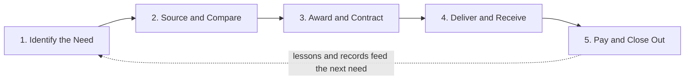

# Procurement Essentials
## Module 1: Procurement Fundamentals

**Audience:** Reps, Ops, Managers (internal)
**Lessons:** 1.1 What Procurement Is · 1.2 Who's Involved · 1.3 The Core Procurement Cycle
**Tone:** Plain language. No prior procurement knowledge assumed.

---

## Lesson 1.1: What Procurement Is (and Isn't)

> **🎯 Objective**
> By the end of this lesson you can explain what procurement is in one sentence, and tell it apart from "purchasing" and "buying."

### Chunk 1: The short version

**Procurement** is the organized process an organization uses to get the goods and services it needs, from working out what the need is through paying for it.

Every organization buys things: a coffee shop buys beans, a hospital buys MRI machines, and a city buys road salt. What makes the buying procurement is the process behind it. Without one, a purchase is whatever someone happened to put on a credit card; with one, the organization has a repeatable way to decide what to buy, from whom, at what price, and on what terms.

### Chunk 2: Procurement vs. purchasing vs. buying

People use these three words interchangeably in conversation, though each covers a different amount of the same activity. Buying is the act of acquiring something, purchasing is the transactional side of it, and procurement is the whole process wrapped around both.

| Term | What it covers | Example |
|---|---|---|
| **Buying** | The act of acquiring something | Ordering 10 laptops |
| **Purchasing** | The transaction side: the order, the PO, the payment | Issuing the purchase order and paying the invoice |
| **Procurement** | The whole process, including defining the need, finding suppliers, comparing offers, negotiating, awarding, receiving, and paying | Everything from "we need laptops" to "laptops are delivered and paid for" |

A simple way to keep them apart is by size. Buying is a single moment, purchasing is a transaction with several steps, and procurement is the process that contains both.

### Chunk 3: Why organizations bother with a process

A formal process earns its keep in four ways that reinforce each other. Comparing options instead of taking the first one holds costs down, and vetting suppliers before depending on them lowers the chance of a bad surprise later. A record of who decided what, and why, gives the organization an answer when someone asks about a purchase months afterward. Consistent rules mean that a purchase made in March is handled the same way as one made in November, whoever happens to be making it.

The larger the organization, and the more it answers to others for how it spends money, the more formal the process tends to become, which is the subject of Module 2.

> **🔁 Retrieval Practice (answer before moving on)**
> 1. In your own words, what is the difference between purchasing and procurement?
> 2. A clinic manager orders ten laptops on a company card, with no comparison of options and no record of who approved it. Which benefits of a formal process are missing?

> **📌 Takeaway**
> Procurement covers everything from recognizing a need to paying for what arrives, which is why placing the order is only one small part of it.

> **💬 When you're talking to a buyer**
> Buyers often use "procurement" to mean their entire function rather than just the placing of orders, so using the word the same way shows you understand how they see their work.

---

## Lesson 1.2: Who's Involved

> **🎯 Objective**
> By the end of this lesson you can name the main roles in a procurement and describe what each one cares about.

### Chunk 1: Two sides of every transaction

Every transaction has two sides: the **buyer**, which is the organization that needs something and pays for it, and the **supplier**, which provides it. Supplier goes by several names depending on the setting. "Vendor" is common in government, "supplier" is common in private industry, and "contractor" usually implies services or construction work, but the terms overlap heavily, so expect to hear them mixed.

### Chunk 2: The roles inside a buying organization

Titles differ from one organization to the next, but the functions behind them are consistent.

| Function | What they do | What they care about |
|---|---|---|
| **Requester / end user** | The person or department with the need | Getting the right thing, on time |
| **Procurement / purchasing staff** | Run the process: sourcing, comparing, awarding | Following the process, value, avoiding mistakes |
| **Approver** | Authorizes spending (a manager, director, or board, depending on amount) | Budget, justification |
| **Finance / accounts payable** | Confirms funds and pays invoices | Accuracy, documentation, timing |
| **Legal / contracts** | Reviews terms for larger or riskier deals | Liability, compliance |
| **Receiving / operations** | Confirms what arrived matches what was ordered | Quality, quantity |

> **Why this matters:** In most organizations the person who wants the product isn't the person who buys it, and neither is the person who approves it, so a deal can stall at any of those seats.

> **Varies by jurisdiction / organization:** Small organizations may have one person doing several of these jobs, while large ones split them across departments. Since there's no reliable way to tell from the outside, it's safer to confirm who holds the decision than to assume the person you're talking to does.

### Chunk 3: The supplier side

Suppliers have functions of their own: sales finds and wins opportunities, proposal or bid staff respond to formal requests, delivery or operations does the work, and billing collects payment. Their goals mirror the buyer's, because they want to win the work, deliver it well, and get paid for it.

> **🔁 Retrieval Practice**
> 1. A department head says "we need new software." Which procurement role is that, and are they necessarily the one who buys it?
> 2. Why might a deal stall even after the end user says yes?

> **📌 Takeaway**
> Needing, buying, approving, and paying are usually handled by different people, so knowing who sits in each seat tells you much of what you need to understand about a given procurement.

> **💬 When you're talking to a buyer**
> Asking who else is involved in the decision is a normal question, and the answer shows where the deal actually lives.

---

## Lesson 1.3: The Core Procurement Cycle

> **🎯 Objective**
> By the end of this lesson you can walk through the five core stages of procurement in order and explain what happens at each.

### Chunk 1: The five stages

This is the simplified, universal version. Later modules add detail on budgeting, formal solicitations, evaluation, and administration, but every procurement, from a box of pens to a bridge, is some version of these five stages.

### Chunk 2: What happens at each stage

1. **Identify the need.** Someone defines what is needed, how much, by when, and roughly what it should cost. Weak definitions at this point cause most of the problems that appear later.
2. **Source and compare.** The buyer finds possible suppliers and gathers prices or proposals. Depending on the size of the purchase and the rules in play, this can be a quick phone call or a formal competitive process.
3. **Award and contract.** The buyer selects a supplier and formalizes the deal through a purchase order, a contract, or both.
4. **Deliver and receive.** The supplier provides the goods or services, and the buyer checks that they match what was agreed.
5. **Pay and close out.** The supplier invoices, the buyer pays, and the records are kept. Any leftover issues, such as warranty claims, disputes, or performance notes, are settled here.

> **Varies by jurisdiction / organization:** How formal each stage is depends on the size of the purchase and the rules the buyer must follow. A small purchase might compress the first three stages into one conversation, whereas a large one can take months, yet the stages themselves stay the same and only the paperwork around them changes.

### Chunk 3: The loop

The dotted line back to the start of the diagram marks a loop. What a buyer learns from one procurement, such as which suppliers performed and what things really cost, shapes the next one, which is one reason suppliers who deliver well tend to be considered again.

### Chunk 4: Glossary for this module

| Term | Meaning |
|---|---|
| **Procurement** | The full process an organization follows to acquire goods and services, from identifying the need to paying for it |
| **Purchasing** | The transactional part of acquiring something: ordering and paying |
| **Buyer** | An organization that acquires goods or services |
| **Supplier / Vendor / Contractor** | A party that provides goods or services to a buyer |
| **Requester / End user** | A person or department that has a need and starts a purchase |
| **Purchase order (PO)** | A document a buyer issues to authorize a purchase from a supplier |
| **Invoice** | A bill a supplier sends for goods or services delivered |
| **Sourcing** | The work of finding and evaluating potential suppliers |
| **Award** | The buyer's decision to select a supplier |

> **🔁 Retrieval Practice**
> 1. Put these in order: Pay and close out · Identify the need · Deliver and receive · Award and contract · Source and compare.
> 2. At which stage do most downstream problems start, and why?
> 3. A school district buys a box of pens, and later a bridge is built for the same district. What stays the same across the two purchases, and what changes?

> **📌 Takeaway**
> Every procurement moves through the same five stages, and the size of the purchase and the rules that apply change how formal each stage is rather than whether it happens.

> **💬 When you're talking to a buyer**
> Which stage a buyer is in tells you what they need from you at that moment: clarity at stage 1, comparison material at stage 2, paperwork at stage 3, and so on.

---

## 🔒 Module 1 Mastery Check

*Locked until all three lessons are complete. Suggested pass mark: 80%.*

**Q1.** Which best describes procurement?
- A. Placing an order and issuing the purchase order to a supplier
- **B. The full process from identifying a need through payment and close-out** ✅
- C. Paying a supplier's invoice and filing the records
- D. Comparing prices from two or more vendors before choosing one

**Q2.** A department manager says they need new equipment and the budget is available. What can you reasonably assume?
- A. They'll place the order themselves once the budget is confirmed
- B. The purchase is already approved because the funds exist
- C. They're the contact the supplier will send invoices to
- **D. Procurement, approvers, and finance are likely still involved** ✅

**Q3.** "Vendor," "supplier," and "contractor" are:
- **A. Overlapping terms for the party that provides goods or services** ✅
- B. Three separate roles with distinct duties in a purchase
- C. Titles for people inside the buying organization
- D. Different names for the person who approves spending

**Q4.** In the five-stage cycle, which stage comes immediately after "Award and contract"?
- A. Source and compare
- B. Identify the need
- **C. Deliver and receive** ✅
- D. Pay and close out

**Q5.** A small purchase and a large purchase differ mainly in:
- A. Which stages they follow
- **B. How formal each stage is** ✅
- C. Whether a need has to be defined first
- D. Whether a supplier is involved

---

### Author's notes (remove before publishing)

- **Lesson 1.1 deliberately previews "public vs. private"** in one sentence only; the full treatment lives in Module 2.
- **No dollar thresholds or legal specifics appear in Module 1.** Those arrive in Modules 3 to 6 and will be verified against current sources at that time.
- **Diagram:** the Mermaid block is ready for the lesson renderer; if the platform doesn't support the `-.label.->` edge syntax, swap for a plain dotted arrow.
- **Glossary rows** are written to map directly onto `glossary_terms` for flashcards.
- **Style pass:** retrieval questions in 1.1 and 1.3 were changed to application scenarios; glossary definitions now begin with the category of thing they describe.
