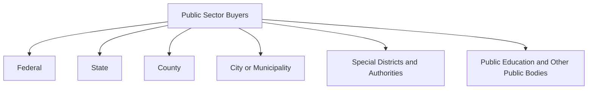
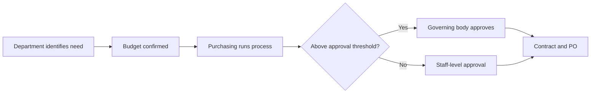

# Procurement Essentials
## Module 2: The Public Procurement Landscape

**Audience:** Reps, Ops, Managers (internal)
**Lessons:** 2.1 Public vs. Private Buying · 2.2 Who Buys in the Public Sector · 2.3 Who Decides Inside a Government Buyer
**Tone:** Plain language. Examples are generic; specifics vary by jurisdiction.

---

## Lesson 2.1: Public vs. Private Buying

> **Objective**
> By the end of this lesson you can explain why government buying works differently from private-company buying, and name the three principles that drive most of the differences.

### Chunk 1: Same cycle, different pressure

The five-stage cycle from Module 1 (identify the need, source and compare, award and contract, deliver and receive, pay and close out) applies to every buyer. What changes in the public sector is the pressure around each stage.

A private company spends its own money and answers to its owners or investors. A public agency spends **public money**, which comes from taxpayers, and it answers to the public, elected officials, auditors, and the law, all of whom can ask how a given dollar was spent.

### Chunk 2: The three principles

Most of the differences between public and private buying trace back to three ideas.

| Principle | What it means | What you'll see in practice |
|---|---|---|
| **Competition** | Suppliers get a fair chance to compete for the work | Formal solicitations, published opportunities, multiple quotes or bids |
| **Transparency** | The public can see how money is spent and why | Public notices, public bid openings, records that can be requested |
| **Accountability** | Decisions must be documented and defensible | Written criteria, scoring, approvals, audit trails |

### Chunk 3: What this changes day to day

Because of these principles, public buying follows written rules rather than personal judgment alone, whether those rules take the form of procurement laws, codes, or local policies. The process also tends to be slower and better documented than a private purchase, since each step exists so that the decision can be explained later to an auditor, a board, or a losing bidder.

The same rules change how relationships work. A buyer may be perfectly friendly and still be unable to favor one supplier, and rules about gifts, contact during a solicitation, and conflicts of interest are common for that reason. Many jurisdictions also let losing bidders protest an award, which is why buyers document so much of what they do.

> **Varies by jurisdiction:** The specific laws, thresholds, and formalities differ by state, county, city, and agency, though the three principles hold almost everywhere.

> **Retrieval Practice**
> 1. Name the three principles behind most public-sector buying rules.
> 2. A public buyer is warm and responsive but declines to discuss your competitors' pricing or give you early access to a bid. What explains that?

> **Takeaway**
> Public buyers use the same cycle as everyone else, but competition, transparency, and accountability shape how each stage is carried out.

> **When you're talking to a buyer**
> Expect a public buyer to talk about process, documentation, and compliance, and respect those constraints, because doing so builds trust faster than pushing for speed does.

---

## Lesson 2.2: Who Buys in the Public Sector

> **Objective**
> By the end of this lesson you can name the main types of public buyers and describe how they differ in size and structure.

### Chunk 1: The levels of government

| Buyer type | What they typically buy for | Notes |
|---|---|---|
| **Federal** | National agencies and programs | Largest buyer; governed by federal rules |
| **State** | State agencies, programs, and infrastructure | Often has a central purchasing office plus agency-level buying |
| **County** | Courts, roads, public safety, health and human services | Mix of centralized and departmental purchasing |
| **City / municipality** | Public works, utilities, parks, local services | Wide range from very small to very large |
| **Special districts and authorities** | A single purpose (water, transit, ports, airports) | Often have their own boards and purchasing rules |
| **Public education and other public bodies** | School districts, colleges, universities, housing authorities | Frequently have separate rules from the city or county they sit in |

### Chunk 2: Size changes the experience

A large state agency may have a dedicated purchasing team, formal procedures, and electronic bidding, whereas a small town may have one clerk handling purchasing alongside several other duties. The principles are the same in both places, but the capacity to carry them out is very different.

> **Varies by jurisdiction:** Which entities exist, how they overlap, and which rules apply to each depends on the state and locality. It's risky to assume a school district follows the same rules as the city around it.

### Chunk 3: Why the layers matter

Each public entity is usually its own buyer, with its own budget, board, and rules, so winning work with one tells you little about how another will behave. Some entities can buy off each other's contracts, which Module 3 covers. Money also flows between levels, as when a federal or state grant funds a local purchase, and that money can come with extra requirements the local buyer has to follow.

> **Retrieval Practice**
> 1. Name four types of public-sector buyers.
> 2. A colleague says the school district across town must follow the same purchasing rules as the city, since they share a boundary. Why is that a risky assumption?

> **Takeaway**
> The public sector is made up of many separate buyers, each with its own budget, governing body, and rules.

> **When you're talking to a buyer**
> Start by learning what kind of entity you're talking to, since that tells you who decides, how formal the process is likely to be, and which rules probably apply.

---

## Lesson 2.3: Who Decides Inside a Government Buyer

> **Objective**
> By the end of this lesson you can describe the typical roles inside a public buyer and how a purchase moves between them.

### Chunk 1: The roles

| Role | What they do | What they care about |
|---|---|---|
| **Department / end user** | Has the need and defines what is required | Getting something that works, on time |
| **Purchasing / procurement office** | Runs the process, enforces the rules | Compliance, fairness, documentation |
| **Contracting or legal staff** | Reviews terms and risk | Liability, enforceability |
| **Finance / budget office** | Confirms funds exist | Budget limits, proper coding of spending |
| **Governing body (council, board, commission)** | Approves larger purchases and sets policy | Public accountability, value, community impact |
| **Elected or appointed executive** | Oversees operations (mayor, county manager, superintendent, director) | Priorities, politics, results |
| **Auditors / oversight** | Review after the fact | Whether rules were followed |

### Chunk 2: How a purchase typically moves

The person who wants the item, the person who runs the process, and the person who approves it are usually three different people. Bigger purchases pull in more of them, and often include a public meeting.

> **Varies by jurisdiction:** The dollar level at which a board or council must approve a purchase differs widely, and so does who counts as the "purchasing office." Smaller entities may combine several of these roles in one person.

### Chunk 3: Glossary for this module

| Term | Meaning |
|---|---|
| **Public sector** | The part of the economy made up of government and publicly funded bodies |
| **Public procurement** | Procurement carried out by public entities using public funds |
| **Competition** | A principle that gives qualified suppliers a fair chance to win |
| **Transparency** | A principle that keeps buying decisions open to public view |
| **Accountability** | A principle that requires decisions to be documented and justified |
| **Governing body** | The council, board, or commission that sets policy and approves spending |
| **Special district / authority** | A single-purpose public entity, such as one for water or transit |
| **Protest** | A formal challenge to an award or solicitation |
| **Public funds** | Money that comes from taxes, fees, and public grants |

> **Retrieval Practice**
> 1. Who usually runs the buying process inside a government buyer, and who usually has the need?
> 2. A city department wants to buy equipment that costs more than the staff approval limit. What typically happens next?
> 3. Why are auditors included in the list of roles, given that they don't take part in the purchase itself?

> **Takeaway**
> Public purchases move through several hands, and the larger ones need approval from a governing body in public view.

> **When you're talking to a buyer**
> Asking who else needs to approve and when the governing body meets is worthwhile, because board and council calendars often decide when a purchase can happen.

---

## Module 2 Mastery Check

*Locked until all three lessons are complete. Suggested pass mark: 80%.*

**Q1.** Which three principles drive most differences between public and private buying?
- A. Speed, price, and convenience
- B. Loyalty, discretion, and volume
- **C. Competition, transparency, and accountability** (correct)
- D. Branding, reputation, and timing

**Q2.** A friendly public buyer can't give you an inside track mainly because:
- A. Public buyers are told to avoid working with outside suppliers
- B. Their budgets are fixed, so there's nothing to negotiate
- C. Contact with suppliers is limited to written communication
- **D. Rules require fair competition and documented decisions** (correct)

**Q3.** Which statement about public buyers is most accurate?
- **A. Each entity is usually its own buyer, with its own budget, governing body, and rules** (correct)
- B. Government buyers at every level follow the same set of rules
- C. Only federal agencies run formal purchasing processes
- D. School districts follow the purchasing rules of the city they sit in

**Q4.** Inside a government buyer, who typically runs the buying process?
- A. The department that has the need
- B. The auditors who review spending
- **C. The purchasing or procurement office** (correct)
- D. The governing body that approves the budget

**Q5.** What commonly happens when a purchase exceeds a set dollar level?
- A. It's cancelled and has to be resubmitted the next fiscal year
- **B. It requires approval from a governing body such as a board or council** (correct)
- C. It skips the usual review because of its size
- D. It must be awarded to a single source

---

### Author's notes (remove before publishing)

- Module 2 is conceptual and contains no dollar figures or legal citations. Thresholds and codes start in Module 3 and will be verified against current sources.
- The Mermaid diagrams use plain syntax for renderer compatibility.
- Glossary rows are written to map onto `glossary_terms` for flashcards.
- Module 3 will carry the heaviest "varies by jurisdiction" load, so I'd suggest we agree on a standard callout style for it before drafting.
- Style pass: retrieval questions rewritten as application scenarios where possible; glossary definitions begin with the category of thing they describe.
