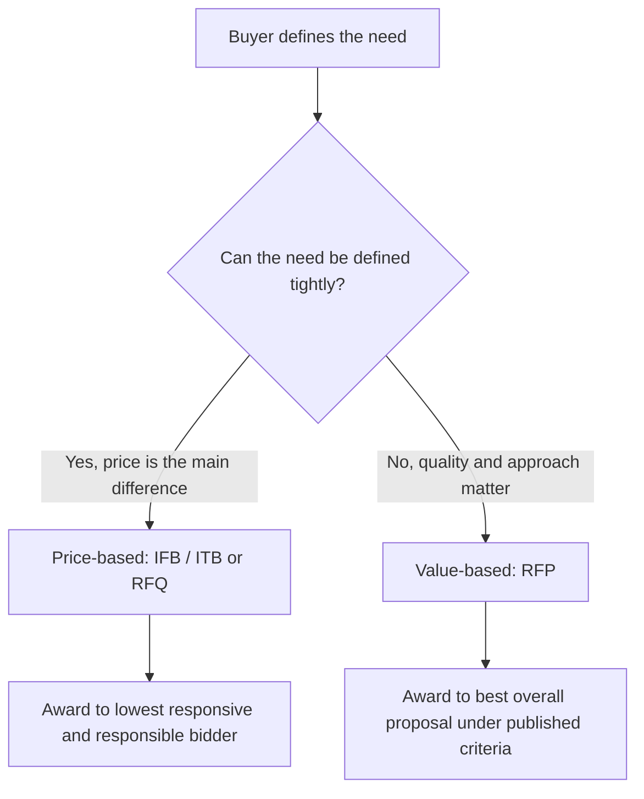

# Procurement Essentials
## Module 5: Solicitations, Contracts and Purchasing Vehicles

**Audience:** Reps, Ops, Managers (internal)
**Lessons:** 5.1 Solicitation Types · 5.2 Choosing Between Price and Value · 5.3 Contract Types: Who Carries the Cost Risk · 5.4 Purchasing Vehicles: Master Agreements and Indefinite-Quantity Contracts
**Tone:** Plain language. Terminology varies by entity; this module teaches the common meanings and how to check.

---

## Lesson 5.1: Solicitation Types

> **Objective**
> By the end of this lesson you can define the common solicitation types (RFI, RFQ, IFB/ITB, RFP) and recognize when each is typically used.

### Chunk 1: The alphabet soup

Public buyers use different documents for different situations, and the table below lists the common ones.

| Type | Stands for | Typical use |
|---|---|---|
| **RFI** | Request for Information | Gathers information about the market or options before a purchase; it does not buy anything |
| **RFQ** | Request for Quotation (or Quotes) | Clearly defined needs where price is the main difference; often faster and lighter |
| **IFB / ITB** | Invitation for Bid / Invitation to Bid | Tightly defined specifications; award typically goes to the lowest responsive and responsible bidder |
| **RFP** | Request for Proposal | Needs where more than price matters (experience, approach, service levels); award weighs these factors together with cost |

### Chunk 2: Words that trip people up

Two terms in bidding are easy to confuse. A bid is **responsive** when it followed the instructions and met the requirements, and a bidder is **responsible** when it's capable of performing the work, for example because it's qualified and financially sound. A low bid that is either not responsive or not responsible can be rejected.

The abbreviations themselves cause trouble as well. RFQ has two meanings: it can stand for Request for **Quotes**, which is price-based and often informal, or for Request for **Qualifications**, which selects a firm on its qualifications and is used in some places for design and engineering services. Since the two work quite differently, check the document. IFB and ITB, by contrast, are used interchangeably in many places.

### Chunk 3: The name does not control

A document's title matters less than the process that law or policy requires for that kind of purchase, so a solicitation called one thing may be required to follow another process. If grant funding is involved, the grant's requirements apply as well.

> **Varies by jurisdiction:** Which type a buyer may use for which purchase is usually set by state law or local policy. Some entities use lighter hybrids, sometimes called "RFP lite," and the same term can carry different requirements in different places.

> **Retrieval Practice**
> 1. Which solicitation type does not buy anything?
> 2. A low bidder followed every instruction in the bid package but has never completed a project of this size and has no financing in place. Is the bid responsive, responsible, both, or neither?
> 3. Name the two meanings of RFQ.

> **Takeaway**
> RFI informs, RFQ prices, IFB/ITB awards on low bid, and RFP weighs value, but terms vary by entity, which is why the document is worth reading and not just the title.

> **When you're talking to a buyer**
> When a buyer says "we're putting out an RFQ," ask what they mean by it, because the question takes ten seconds and keeps you from preparing the wrong kind of response.

---

## Lesson 5.2: Choosing Between Price and Value

> **Objective**
> By the end of this lesson you can explain why a buyer picks a price-based or value-based method, and what that means for how a response is judged.

### Chunk 1: Two award logics

| | Price-based (IFB/ITB, RFQ) | Value-based (RFP) |
|---|---|---|
| **Best when** | Specifications are precise; goods are standard | Needs are complex; approach and experience matter |
| **How award is decided** | Lowest price among those who qualify | Published criteria weighing price with other factors |
| **Negotiation** | Typically limited or none | Often allowed in some form, depending on rules |
| **Effort for both sides** | Lower | Higher |

### Chunk 2: A common mistake

Teams often misread "lowest bid" rules. In a price-based process, the buyer generally can't choose a more expensive bidder because they like that bidder better. In a value-based process the lowest price doesn't automatically win, yet the buyer is still limited to the published criteria when deciding.

### Chunk 3: Why the choice of method is not about dollar size

The choice usually depends on complexity, on how much quality matters, and on how much flexibility the buyer needs, and not simply on how much money is involved. The dollar thresholds in Module 3 decide how formal the process must be, which is a separate question from which philosophy it follows.

> **Varies by jurisdiction:** Some jurisdictions require price-based bidding for certain purchases, such as standard supplies or construction above a set amount, and allow value-based methods only for specific categories such as technology or professional services.

> **Retrieval Practice**
> 1. When is a price-based method most appropriate?
> 2. A buyer ran an RFP, and a committee member suggests choosing the firm everyone already likes, which didn't score highest. What limits the buyer here?
> 3. Does the dollar amount alone decide whether a buyer uses an IFB or an RFP?

> **Takeaway**
> Price-based methods reward the lowest qualified price, while value-based methods reward the best overall proposal under the published criteria.

> **When you're talking to a buyer**
> Understanding which logic the buyer is using tells you what they care about, whether that's precision and price or approach and experience.

---

## Lesson 5.3: Contract Types: Who Carries the Cost Risk

> **Objective**
> By the end of this lesson you can describe the main ways contracts set price and explain who carries the risk of cost overruns under each.

### Chunk 1: The core idea

Contract types differ mostly in how they answer one question: **if the work costs more or less than expected, who feels it?**

| Type | How price works | Who carries cost risk |
|---|---|---|
| **Fixed price** | One agreed price for defined work | The supplier |
| **Fixed price with incentives** | Target price with adjustments for performance or cost outcomes, often with a ceiling | Shared |
| **Time and materials (T&M)** | Buyer pays set hourly rates for labor plus the cost of materials, usually up to a limit | Mostly the buyer, with a cap as protection |
| **Cost-reimbursement** | Buyer reimburses allowed costs plus a fee, usually up to an estimate | Mostly the buyer |
| **Unit price** | A set price per unit (per item, per hour, per ton), with the total depending on quantity ordered | Depends on volume |

### Chunk 2: Why a buyer picks one

Fixed price fits well-defined work, where the supplier can estimate costs reliably, and it's common in sealed-bid, price-based processes. Time and materials and cost-reimbursement contracts suit work that is hard to define in advance, but they need more oversight because the final cost isn't known up front. Incentive structures try to reward efficiency or performance by tying fees or profit to outcomes.

### Chunk 3: Where you'll see them

At the state and local level, fixed-price and unit-price arrangements are very common. Cost-reimbursement structures show up more in the federal world and in specialized work, so treat the federal-style variations (cost-plus-fixed-fee, award-fee, and similar) as awareness and not as daily vocabulary.

> **Varies by jurisdiction:** Some entities restrict certain contract types, for example by limiting cost-based pricing, or they require extra approval for open-ended arrangements.

> **Retrieval Practice**
> 1. Under a fixed-price contract, who carries cost-overrun risk?
> 2. A city hires a firm to repair storm damage whose full extent won't be known until crews start digging. Which pricing structure fits best, and what protection should the city expect?
> 3. Why would a buyer choose a unit-price contract?

> **Takeaway**
> Contract types allocate cost risk, and the tighter the scope, the more a buyer can push that risk to the supplier with a fixed price.

> **When you're talking to a buyer**
> Listening to which pricing structure a buyer prefers shows how confident they are in their scope and how they want to manage risk.

---

## Lesson 5.4: Purchasing Vehicles: Master Agreements and Indefinite-Quantity Contracts

> **Objective**
> By the end of this lesson you can explain what a purchasing vehicle is and how buyers use agreements that are competed once and used many times.

### Chunk 1: One competition, many purchases

A **purchasing vehicle** is an agreement set up so that a buyer can make repeated purchases without running a full competition each time. It takes several common forms.

| Vehicle | General idea |
|---|---|
| **Master agreement / price agreement** | Pre-negotiated terms and prices with one or more suppliers; buyers order as needed |
| **On-call / as-needed contract** | A supplier is available to be called when a need arises (common for recurring services) |
| **Indefinite-quantity (IDIQ-style) contract** | A contract for an unspecified quantity within stated limits and a fixed period; specific work is ordered through task or delivery orders |
| **Blanket purchase agreement (BPA)** | A simplified arrangement for repeat purchases of similar items |
| **Cooperative contract** | A contract competed by another entity that others may use (Module 3) |

### Chunk 2: How indefinite-quantity contracts work

The federal definition serves as the model here. An indefinite-quantity contract covers an **indefinite quantity** of goods or services within **stated limits** over a **fixed period**, often a base period with optional extension years. A **minimum guarantee** commits the buyer to purchase at least a set amount, and specific needs are filled by **task orders** (for services) or **delivery orders** (for supplies) placed as they arise, with the price and detail fixed when each order goes out.

Who holds the contract is the other major variable. Under a **single award**, one supplier holds it, which is simpler but can lock the buyer in to that vendor. Under a **multiple award**, several qualified suppliers hold contracts and each order is competed among them, an arrangement generally favored for keeping competition alive.

### Chunk 3: Why it matters to suppliers

Winning a vehicle often means getting on a list and not receiving any guaranteed work. Revenue depends on orders actually being placed and, in multiple-award vehicles, on winning them.

### Chunk 4: Glossary for this module

| Term | Meaning |
|---|---|
| **RFI** | A request for information that gathers market information |
| **RFQ** | A request for quotes (price-based) or for qualifications (qualification-based), depending on the entity |
| **IFB / ITB** | An invitation for bid, or to bid, awarded to the lowest responsive and responsible bidder |
| **RFP** | A request for proposal, awarded on best overall value |
| **Responsive** | Describes a bid that follows instructions and meets requirements |
| **Responsible** | Describes a bidder that is capable of performing the work |
| **Fixed price** | A pricing type with a set price regardless of actual cost |
| **Time and materials** | A pricing type with hourly labor rates plus materials, typically capped |
| **Cost-reimbursement** | A pricing type in which the buyer reimburses allowed costs plus a fee |
| **Unit price** | A pricing type with a set price per unit, so the total depends on quantity |
| **Master / price agreement** | An arrangement with pre-negotiated terms for repeated orders |
| **On-call contract** | An agreement that keeps a supplier available as needs arise |
| **IDIQ** | An indefinite delivery, indefinite quantity contract |
| **Task / delivery order** | A specific order placed under an indefinite-quantity contract |
| **Single / multiple award** | A choice between one supplier and several qualified suppliers on a vehicle |

> **Retrieval Practice**
> 1. What is the main supplier risk of winning a place on a vehicle?
> 2. What is the difference between a task order and a delivery order?
> 3. Why do many buyers prefer multiple-award vehicles?

> **Takeaway**
> A vehicle is an agreement competed once and used many times, and being on one creates opportunity without guaranteeing revenue.

> **When you're talking to a buyer**
> Ask whether the purchase will run through an existing vehicle, since in that case the competition may already be over and the conversation is about how to get on, or use, that vehicle.

---

## Module 5 Mastery Check

*Locked until all four lessons are complete. Suggested pass mark: 80%.*

**Q1.** Which solicitation type is used only to gather information and does not buy anything?
- A. IFB
- B. RFQ
- **C. RFI** (correct)
- D. RFP

**Q2.** An IFB/ITB is typically awarded to:
- A. The firm with the strongest presentation and references
- B. The most experienced firm among those who bid
- C. The first qualified bidder to submit a response
- **D. The lowest responsive and responsible bidder** (correct)

**Q3.** What does "responsible" mean for a bidder?
- A. The bid was submitted before the deadline
- **B. The bidder is capable of performing the work** (correct)
- C. The bid followed the required format and forms
- D. The bid had the lowest price of those received

**Q4.** Under a firm fixed-price contract, who carries the risk of cost overruns?
- A. The buyer, who pays whatever the work ends up costing
- B. Both sides equally, unless the contract says otherwise
- **C. The supplier** (correct)
- D. The agency's auditor

**Q5.** Why do T&M contracts usually include a cap?
- A. To make the contract less expensive for the supplier to perform
- B. To remove the need for hourly rates in the contract
- C. To avoid the documentation a fixed-price contract needs
- **D. To protect the buyer from open-ended cost** (correct)

**Q6.** In an indefinite-quantity contract, how is a specific need fulfilled?
- **A. Through task or delivery orders placed under the contract** (correct)
- B. Through a new solicitation each time a need arises
- C. Through a sole-source award to the original supplier
- D. Through a protest filed by the other qualified suppliers

**Q7.** What does winning a place on a purchasing vehicle usually guarantee?
- A. A fixed amount of revenue over the contract term
- **B. The opportunity to receive orders, without guaranteed work** (correct)
- C. Exclusive rights to every order the buyer places
- D. Protection from competition on future orders

---

### Author's notes (remove before publishing)

- **Source basis.** Solicitation definitions follow a UNC School of Government overview (North Carolina focus) and an E&I overview of solicitation types. Contract-type pricing logic follows a federal-focused summary. IDIQ mechanics follow a Congressional Research Service In Focus (federal, updated Nov. 12, 2024). Both federal sources are used as models, and the lessons say so.
- **Time and materials.** The source I pulled did not explain T&M, so that row reflects the common definition (hourly rates plus materials, usually capped). Worth verifying against a primary source before publishing.
- **Unit price and BPA rows** are also standard definitions not drawn from a fetched source.
- **State/local exceptions.** The "RFQ means qualifications" point comes from one state's practice (North Carolina). It is flagged as varying, but confirm how the states you operate in use the term.
- **No dollar thresholds** appear in this module by design; they live in Module 3.
- Glossary rows map onto `glossary_terms` for flashcards.

### Sources

- [UNC School of Government: The ABCs of IFBs, ITBs, RFPs, RFQs, and RFIs](https://canons.sog.unc.edu/the-abcs-of-ifbs-itbs-rfps-rfqs-and-rfis/)
- [E&I: Types of Solicitation Documents in Procurement](https://www.eandi.org/resources/ei-blog/types-of-solicitation-documents-procurement/)
- [CRS: Indefinite Delivery, Indefinite Quantity Contracts (IF12558)](https://www.everycrsreport.com/reports/IF12558.html)
- [Contract types explained (CBH)](https://www.cbh.com/insights/articles/far-government-contract-types-explained/)
