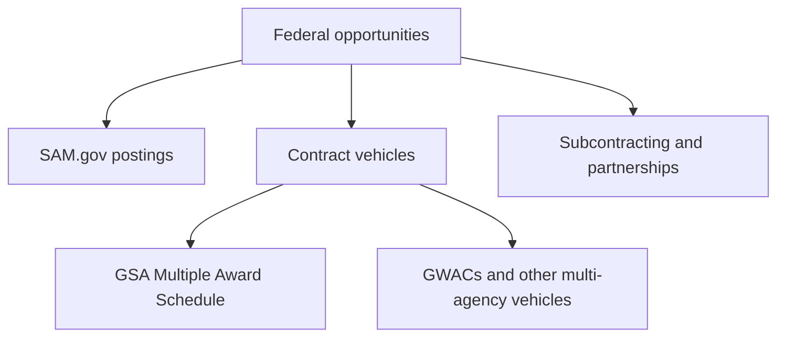

# Procurement Essentials
## Module 7: The Federal Snapshot (GovCon)

**Audience:** Reps, Ops, Managers (internal)
**Lessons:** 7.1 How Federal Buying Differs · 7.2 The FAR and the Federal Thresholds · 7.3 Finding Federal Opportunities · 7.4 Federal Small Business Programs
**Tone:** Plain language. This is a deliberately light overview. Our focus is state, county and local; this module exists so the team can hold a sensible conversation when federal comes up.
**Currency note:** Federal rules and thresholds change. Figures below are current as of the sources listed at the end (late 2026) and carry an "as of" label wherever they appear.

---

## Lesson 7.1: How Federal Buying Differs

> **Objective**
> By the end of this lesson you can explain, in plain terms, how federal buying differs from state and local buying, and why we treat it as a snapshot.

### Chunk 1: One rulebook, many agencies

State and local buying is a patchwork in which every entity sets its own rules (Module 3), and federal buying is closer to the opposite. A single government-wide regulation, the **Federal Acquisition Regulation (FAR)**, governs most executive-branch purchasing, and agencies add their own supplements on top.

| | State / county / local | Federal |
|---|---|---|
| **Rulebook** | Many, different per entity | One main regulation (FAR) plus agency supplements |
| **Where opportunities post** | Entity websites, bid portals, various | Largely one place: SAM.gov |
| **Scale** | Wide range, usually smaller | Very large, with big multi-year vehicles |
| **Registration** | Varies; often vendor registration with each entity | A government-wide registration is needed to receive awards |
| **Small business programs** | Vary widely | Standardized national programs and goals |

### Chunk 2: What stays the same

The Module 1 cycle, the Module 4 lifecycle, and the principles from Module 2 (competition, transparency, and accountability) all apply in federal buying as well. The underlying process is the same, though the rulebook around it is longer and the dollar amounts are larger.

### Chunk 3: Why this is a snapshot

Our product and our focus are state and local. The federal world is large, specialized, and changing, so this module teaches vocabulary and orientation and doesn't try to teach anyone how to win federal work.

> **Retrieval Practice**
> 1. Name one major structural difference between federal and state/local rules.
> 2. A colleague says federal buyers don't care about fairness or documentation because they have so much money. Which ideas from Modules 1 to 4 show why that's wrong?

> **Takeaway**
> Federal buying is the same process under one large regulation and one main opportunity portal, and we keep it light because our focus is state and local.

> **When you're talking to a buyer or prospect**
> If someone says "we want to do federal too," listen first. The honest answer is that federal is a different world with a longer runway, and our team shouldn't promise expertise we haven't built.

---

## Lesson 7.2: The FAR and the Federal Thresholds

> **Objective**
> By the end of this lesson you can explain what the FAR is, name the two thresholds that most often come up, and describe why the FAR is in motion right now.

### Chunk 1: What the FAR is

The FAR is the main set of rules for how federal executive agencies acquire goods and services. It covers planning, solicitation, evaluation, contract types, small business programs, and administration, and agencies publish supplements for their own needs.

### Chunk 2: Two thresholds worth knowing

Federal purchasing scales its formality by dollar size, as state and local buying does (Module 3), and two lines come up constantly.

| Threshold | What it generally means | Current figure (as of Oct. 1, 2025) |
|---|---|---|
| **Micro-purchase threshold** | Below it, buyers can make small purchases with minimal competition requirements | $15,000 (was $10,000) |
| **Simplified acquisition threshold (SAT)** | Below it, buyers can use streamlined, simplified procedures | $350,000 (was $250,000) |

The FAR Council adjusts these thresholds for inflation periodically, so numbers that were right a few years ago may be stale. Other thresholds, such as the triggers for cost or pricing data and for subcontracting plans, were adjusted at the same time.

> **Do not repeat these in conversation as permanent facts.** If a federal figure matters to a decision, check acquisition.gov.

### Chunk 3: The FAR is being rewritten

The federal government has been carrying out what it calls the **Revolutionary FAR Overhaul**, which aims to streamline the regulation. Agencies have been applying the streamlined approach through temporary deviations, and in mid-2026 the formal rulemaking process began, with proposed rules released in batches and more still expected.

For us, that has three practical consequences. Specific FAR part language and procedures may shift, so change is the thing to expect. FAR part numbers are more likely to move than the general ideas, so it's wiser to teach only a few well-known ones. And for anything that matters, the right source is the current official one at acquisition.gov.

> **Retrieval Practice**
> 1. What is the FAR?
> 2. A prospect says a purchase just under $300,000 must follow full competition rules because it's "over the federal threshold." Which two thresholds are in play, and what should you do before responding?
> 3. Why should we avoid quoting federal thresholds from memory?

> **Takeaway**
> The FAR is the main federal rulebook, and because its thresholds are adjusted over time and the regulation itself is in the middle of a rewrite, current sources should be checked before relying on any specific.

> **When you're talking to a buyer or prospect**
> If a prospect quotes a federal rule or threshold, don't correct it from memory; say you'll confirm it against the current source.

---

## Lesson 7.3: Finding Federal Opportunities

> **Objective**
> By the end of this lesson you can name the main routes into federal work and describe in one sentence what SAM.gov and contract vehicles are.

### Chunk 1: Three main routes

1. **SAM.gov.** The central federal site where most contract opportunities are posted, and where businesses register to be eligible for awards. Registration steps change and are administered by the government, so always use the official site for current requirements.
2. **Contract vehicles.** Pre-competed agreements that agencies buy from (see Module 5). The **GSA Multiple Award Schedule (MAS)** is a long-running vehicle in which qualified businesses are pre-approved and agencies order from the list; it guarantees no sales. Typical entry requirements include time in business, financial statements, and past performance, with a startup pathway available. **GWACs and other multi-agency contracts** are governmentwide vehicles with limited proposal windows, and most are awarded to large businesses unless set aside for small ones.
3. **Subcontracting and partnering.** Smaller firms often enter federal work by supporting an existing prime contractor, through teaming, joint ventures, or mentor-protégé arrangements, with help from local Procurement Technical Assistance Centers (PTACs).

### Chunk 2: A realistic framing

Most newcomers don't start by winning large federal prime contracts. The common path is to learn the system, register, find smaller opportunities or subcontract roles, and build past performance over time.

> **Retrieval Practice**
> 1. What is SAM.gov used for?
> 2. A small firm has just been added to the GSA Multiple Award Schedule and expects orders to start arriving. What should it understand about what the listing does and doesn't provide?
> 3. Name one way a smaller firm often enters federal work other than winning a prime contract directly.

> **Takeaway**
> SAM.gov is the front door, vehicles are shortcuts for buyers, and subcontracting is a common on-ramp for newcomers.

> **When you're talking to a buyer or prospect**
> If a prospect asks how to get into federal work, point to SAM.gov and PTACs as starting points, and be candid that it's a long game.

---

## Lesson 7.4: Federal Small Business Programs

> **Objective**
> By the end of this lesson you can describe the federal small business goal, the "Rule of Two," and the names of the main preference programs.

### Chunk 1: The goals

Federal agencies have government-wide goals for how much contracting goes to small businesses. As of the source below (updated July 2026), the overall goal is **at least 23%** of prime contract dollars to small businesses. There are also separate goals for small disadvantaged businesses (5%), women-owned small businesses (5%), service-disabled veteran-owned small businesses (5%), and HUBZone small businesses (3%). In fiscal 2025, small businesses received roughly 27.6% of prime dollars.

### Chunk 2: Set-asides and the Rule of Two

Federal competition is generally "full and open," but agencies can reserve certain contracts for small businesses. Under the **Rule of Two**, a contract is set aside when the contracting officer reasonably expects offers from at least two responsible small businesses that are competitive on price, quality, and delivery.

### Chunk 3: The main programs

| Program | Who it serves |
|---|---|
| **8(a) Business Development** | Firms owned and controlled by socially and economically disadvantaged individuals; set-asides, sole-source awards, and business development support, with a nine-year term |
| **HUBZone** | Small businesses located in SBA-designated areas; set-asides, sole-source awards, and a price evaluation preference of up to 10% |
| **WOSB** | Women-owned small businesses, in industries where women-owned firms are substantially underrepresented in federal contracting |
| **SDVOSB** | Firms at least 51% owned and controlled by service-disabled veterans |

> **Do not advise a business on whether it qualifies.** Eligibility is determined through certification, and our role is to describe the programs, not to decide anyone's status.

### Chunk 4: Glossary for this module

| Term | Meaning |
|---|---|
| **FAR** | The Federal Acquisition Regulation, which is the main federal buying rulebook |
| **Revolutionary FAR Overhaul** | The ongoing federal effort to rewrite and streamline the FAR |
| **SAM.gov** | The federal portal for registration and most contract opportunities |
| **Micro-purchase threshold** | A dollar level below which small purchases face minimal competition requirements |
| **Simplified acquisition threshold (SAT)** | A dollar level below which streamlined procedures can be used |
| **GSA MAS** | The GSA Multiple Award Schedule, a long-term list of pre-approved vendors |
| **GWAC** | A governmentwide acquisition contract |
| **Set-aside** | A purchase reserved for qualifying small businesses |
| **Rule of Two** | A test used to decide when to set a contract aside for small business |
| **8(a), HUBZone, WOSB, SDVOSB** | The names of the main federal small business programs |
| **PTAC** | A Procurement Technical Assistance Center, which offers free or low-cost local help for contractors |
| **Prime / subcontractor** | The company that holds a contract / a company that works under it |

> **Retrieval Practice**
> 1. What is the Rule of Two?
> 2. Name two federal small business programs.
> 3. A small business owner asks you directly whether their firm qualifies for HUBZone. Why shouldn't you answer, and what should you do?

> **Takeaway**
> Federal small business programs are standardized and goal-driven, and our role is to describe them, since certifying a business is something only the official process can do.

> **When you're talking to a buyer or prospect**
> If a business asks about a program, explain what it is, point them to the official certification source, and stop there.

---

## Module 7 Mastery Check

*Locked until all four lessons are complete. Suggested pass mark: 80%.*

**Q1.** What is a major structural difference between federal and state/local buying?
- A. Federal buying doesn't use competition between suppliers
- B. Federal buying is done without written contracts
- C. State and local buying is always funded by federal money
- **D. Federal buying runs under one main government-wide regulation, the FAR** (correct)

**Q2.** Where are most federal contract opportunities posted?
- A. In the legal notices of local newspapers
- B. On each buyer's private email list of approved suppliers
- C. Only on GSA schedule pages
- **D. On SAM.gov** (correct)

**Q3.** Why should our team avoid quoting federal dollar thresholds from memory?
- A. The thresholds are confidential and can't be shared
- **B. They are adjusted over time, so they must be checked against current sources** (correct)
- C. They only apply to state and local buyers
- D. They have been the same for decades, so memory is unreliable

**Q4.** Does being on the GSA Multiple Award Schedule guarantee sales?
- A. Yes, because agencies are required to buy from it
- B. Yes, up to a fixed amount set when the supplier joins
- C. Only for large businesses with past performance
- **D. No, it creates an opportunity to be ordered from** (correct)

**Q5.** Which describes the Rule of Two?
- A. A contract can be awarded only when two bidders respond
- B. Two agencies must approve each federal award
- **C. A contract is set aside for small business when the officer reasonably expects offers from at least two responsible, competitive small businesses** (correct)
- D. Each business may hold no more than two federal contracts

**Q6.** A prospect asks whether their company qualifies as a HUBZone business. What is the right response?
- **A. Explain what the program is and point them to the official certification source** (correct)
- B. Tell them yes if the business appears to be small
- C. Tell them no, since eligibility is rare
- D. Offer to fill out the application on their behalf

**Q7.** Which statement about the FAR is most accurate?
- A. It's fixed and hasn't changed in decades
- B. It applies only to defense purchases
- **C. It's being rewritten, so specifics should be checked against current official sources** (correct)
- D. It replaced all state procurement rules

---

### Author's notes (remove before publishing)

- **Currency.** Thresholds ($15,000 micro-purchase, $350,000 SAT) come from the Federal Register inflation adjustment effective Oct. 1, 2025. The small business goals and FY2025 result come from a Congressional Research Service report updated July 21, 2026. Both carry an "as of" label in the lessons. Re-verify close to publication.
- **FAR Overhaul status has conflicting detail across sources.** A White House/OMB release (June 2026) says the first batch of proposed rules covered 17 FAR parts. Law-firm and trade sources describe the first batch as 20 or 21 parts. I deliberately did **not** state a number of parts, only that formal rulemaking began in mid-2026 with more batches expected. Re-check before publishing, since this is moving.
- **SAM.gov registration.** The sources I pulled confirm SAM.gov is the central portal and that registration is how businesses become eligible for awards, but did not give step-by-step requirements. I kept that lesson high-level and told trainees to use the official site. Consider adding detail only after verifying against SAM.gov directly.
- **GSA MAS entry requirements** (time in business, financial statements, past performance, startup pathway) come from GSA's own page and are summarized loosely; confirm current requirements before telling anyone specifics.
- **Federal contract-type content** is deliberately not repeated here; Module 5 covers it.
- **Photo/legal note:** nothing here is legal advice, and Lesson 7.4 explicitly steers trainees away from advising on eligibility.
- Glossary rows map onto `glossary_terms` for flashcards.
- Style pass: the 7.2 retrieval scenario uses an invented "just under $300,000" figure purely to prompt a threshold check, and it deliberately sits between the micro-purchase and simplified acquisition thresholds.

### Sources

- [OMB: Revolutionary FAR Overhaul advances with formal publication (June 2026)](https://www.whitehouse.gov/releases/2026/06/omb-advances-revolutionary-far-overhaul-with-formal-publication-of-regulatory-changes/)
- [Federal Register: FAR Inflation Adjustment of Acquisition-Related Thresholds (Aug. 27, 2025)](https://www.federalregister.gov/documents/2025/08/27/2025-16412/federal-acquisition-regulation-inflation-adjustment-of-acquisition-related-thresholds)
- [CRS: An Overview of Small Business Contracting (R45576)](https://www.everycrsreport.com/reports/R45576.html)
- [GSA: How to access contract opportunities](https://www.gsa.gov/index%2Ephp/sell-to-government/step-1-learn-about-government-contracting/how-to-access-contract-opportunities)
