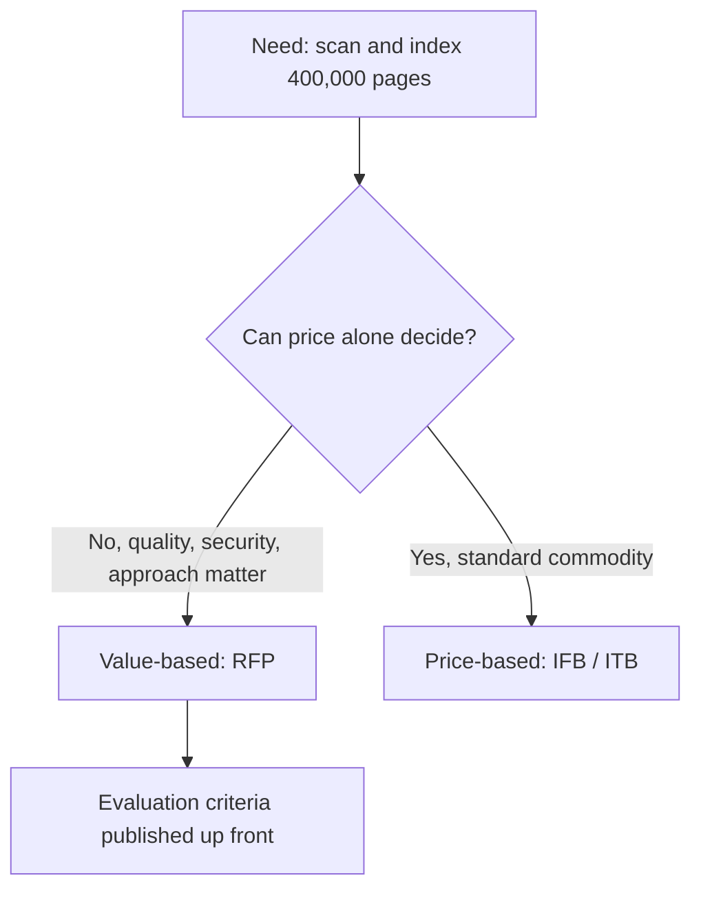

# Procurement Essentials
## Module 8: End-to-End Walkthrough

**Audience:** Reps, Ops, Managers (internal)
**Lessons:** 8.1 The Scenario: Need, Planning and Method · 8.2 Solicitation, Evaluation and Award · 8.3 Delivery, Closeout and the Federal Contrast
**Tone:** Plain language. This module is a story that ties Modules 1 to 7 together.
**Important:** The city, people, dollar figures, thresholds, scoring weights and dates below are **fictional and illustrative**. They show how the pieces fit, not what any real entity does. Real entities set their own rules (Module 3).

---

## Lesson 8.1: The Scenario: Need, Planning and Method

> **Objective**
> By the end of this lesson you can follow a purchase from the first identified need through the choice of method, and name which earlier module each step comes from.

### Chunk 1: Meet the buyer

**The City of Maple Ridge** (fictional) is a mid-sized city with a purchasing office, a city manager, and a city council that meets twice a month. Its Records Department holds thousands of boxes of paper permits and property files, and staff keep receiving public records requests that take days to fulfill because the files are on paper.

### Chunk 2: Stage 1, Requirement (Modules 1 and 4)

The Records Director defines the need: **scan, index, and securely store about 400,000 pages, with searchable results and a way to retrieve files within one business day.** She writes a **scope of work** with a delivery timeline of roughly nine months, and she adds a requirement that the supplier handle the paper securely and return or destroy it as directed.

> **Why it matters:** This is the stage that looks quiet and shapes everything after it, so the clearer the scope is here, the cleaner the rest of the procurement will be.

### Chunk 3: Stage 2, Planning and budget (Module 4)

Planning starts with money. The department confirms $200,000 in its adopted budget for the fiscal year (fictional), and staff gather reference pricing to estimate the cost at about **$180,000**. Purchasing then checks whether a cooperative or existing contract could be used, but none fits the city's security requirements, so a new solicitation is needed.

The city's policy (fictional) says that purchases above **$75,000** require formal competition and that council approval is needed above **$150,000**. At about $180,000, this purchase triggers both.

### Chunk 4: Choosing the method (Module 5)

Quality, security practices, and experience matter as much as price here, so purchasing chooses a **Request for Proposals (RFP)** and not a lowest-price bid. The planned contract structure is a **unit price per page** for scanning plus a **fixed price** for setup and indexing.

> **Retrieval Practice**
> 1. Which stage is the "quiet and powerful" one, and what is produced there?
> 2. Suppose Maple Ridge wanted to buy standard printer paper instead of a scanning service. Which method would fit better, and why?
> 3. What two thresholds applied to this purchase, and what does each trigger?

> **Takeaway**
> By the time anything is published, the need, funding, method, and approvals path have already been decided, so a supplier's chance to shape the outcome is small once the solicitation is public.

> **When you're talking to a buyer**
> The earlier you understand the buyer's need, timing, and budget cycle, the more useful you can be, as long as you stay within their contact rules.

---

## Lesson 8.2: Solicitation, Evaluation and Award

> **Objective**
> By the end of this lesson you can describe what happens from publication of a solicitation through council approval, and what a supplier should and should not do at each step.

### Chunk 1: Solicitation

Maple Ridge publishes the RFP on its bid portal and in a public notice. The document gives the scope of work and the required security practices, a **question deadline** with a single contact for questions, and a proposal deadline. It also carries a **no-contact rule**, under which suppliers may communicate only with the named purchasing contact until the award is announced.

The **evaluation criteria and weights** (fictional) are published as well: technical approach 30%, security and data handling 25%, relevant experience 20%, and price 25%. Finally, the RFP states that proposals become public records after award, with instructions for marking genuine trade secrets.

A supplier asks a question about scanning formats. The city answers it in a written **addendum** sent to everyone who downloaded the RFP, not only to the supplier who asked, so that no bidder has an advantage.

### Chunk 2: What a supplier does here

A well-run supplier reads the entire RFP and follows its instructions exactly, which is what makes a response responsive. Questions go only through the designated channel and before the deadline, and the proposal is written on the assumption that competitors will later read it. The supplier marks only genuine trade secrets, as instructed, and does not call the Records Director, the city manager, or council members.

### Chunk 3: Evaluation

Five proposals arrive, and evaluation moves through four steps.

1. **Compliance check:** One proposal is rejected as non-responsive for missing a required form.
2. **Evaluator disclosures:** Each evaluator signs a conflict-of-interest disclosure. One evaluator discloses that her brother-in-law works for a bidder, and she is replaced.
3. **Scoring:** Evaluators score the four remaining proposals against the published criteria only, and they document their notes.
4. **Ranking:** The bidder with the lowest price ranks third overall because of weaker security and experience scores, which is a normal result under an RFP, where the lowest price doesn't automatically win.

### Chunk 4: Award

The top-ranked proposal is about $176,000, which exceeds the council approval level, so purchasing places a recommendation on the council agenda. At a public meeting, the council approves the award. The city then notifies all bidders and, depending on its rules, offers debriefs.

### Chunk 5: A protest sidebar

The third-ranked bidder believes the winner's scoring was unfair and files a protest within the city's deadline (fictional: a few business days). The city's purchasing director reviews it. Because evaluators scored strictly against the published criteria and documented everything, the protest is denied, and the paper trail is the reason the process held up.

> **Retrieval Practice**
> 1. Why did the city send its answer to the supplier's question to everyone?
> 2. What happened to the evaluator with a family tie to a bidder, and why?
> 3. A losing bidder says the evaluators should have weighed price more heavily. Why did documentation help the city when a protest was filed?

> **Takeaway**
> Fair process shows up at every step of this procurement, in the equal information, the disclosed conflicts, the scoring against published criteria, the public approval, and the records that can be defended.

> **When you're talking to a buyer**
> During an open solicitation, we communicate only through the designated channel. Relationships can be built before a solicitation opens, but not while it's open.

---

## Lesson 8.3: Delivery, Closeout and the Federal Contrast

> **Objective**
> By the end of this lesson you can describe what happens after award, and explain in two or three sentences how the same purchase would differ at the federal level.

### Chunk 1: Contract and administration

The city and supplier finalize the **contract**, including terms, security requirements, and pricing (unit price per page plus fixed setup). A **contract administrator** in the Records Department, who is a different person from the purchasing officer who ran the RFP, monitors progress, and the supplier submits **invoices** that the city reviews against delivered work before paying.

Halfway through, the city decides to add 40,000 more pages. That change is handled through a **formal modification** to the contract and not through a handshake, since the contract is the record both sides will be held to.

### Chunk 2: Closeout

At the end, the city accepts the final deliverables and checks that the paper has been returned or destroyed as required. The final invoice is paid and any retained amount is released. Records are filed and retained, because audits and records requests can come years later, and the supplier's performance is noted, which will influence how the city views them in future procurements. That is the loop from Module 1 closing.

### Chunk 3: The same purchase at the federal level

If a federal agency bought a similar service, the most visible difference would be the rulebook: it would follow the **FAR**, with agency supplements, in place of a local ordinance. The opportunity would most likely be posted on **SAM.gov**, and the supplier would need an active registration to receive an award. The agency might also use an existing **contract vehicle**, such as a GSA schedule, instead of running a new competition.

Two further differences affect who can compete and how formal the process must be. Federal **small business set-aside rules**, such as the Rule of Two, could limit who may compete, and federal thresholds such as the **simplified acquisition threshold** would determine the level of formality, with figures that belong to the federal government and not to the city.

The stages, the principles, and the importance of documentation stay the same, while the rulebook, the portal, and the scale are different.

### Chunk 4: The whole journey on one page

| Stage | What happened in Maple Ridge | Module |
|---|---|---|
| Requirement | Records Director wrote a scope of work | 1, 4 |
| Planning and budget | Funding confirmed, estimate built, method chosen | 3, 4 |
| Solicitation | RFP published with criteria and no-contact rule | 4, 5, 6 |
| Evaluation | Compliance check, disclosures, documented scoring | 4, 6 |
| Award | Council approved in public | 2, 3 |
| Protest | Reviewed and denied, thanks to documentation | 6 |
| Administration | Contract administrator, modification, invoices | 4 |
| Closeout | Acceptance, final payment, records retained | 4 |

> **Retrieval Practice**
> 1. Why was the extra 40,000 pages handled by a modification?
> 2. Name two things that would differ if a federal agency bought the same service.
> 3. A new rep says the federal version of this purchase would ignore documentation because the agency is so large. What stays the same across state/local and federal buying?

> **Takeaway**
> Every purchase follows the same journey, and the size, rulebook, and approval path change while fairness, competition, and documentation stay constant.

> **When you're talking to a buyer**
> Knowing which stage a buyer is in, and what rules they are under, tells you what they need from you right now and what you must not do.

---

## Module 8 Mastery Check

*Locked until all three lessons are complete. Suggested pass mark: 80%.*

**Q1.** In the scenario, why did Maple Ridge use an RFP instead of an IFB?
- A. The purchase was too small to justify an IFB
- B. State law prohibits IFBs for services of any kind
- C. The city council had directed the use of an RFP
- **D. Quality, security, and approach mattered as much as price** (correct)

**Q2.** A supplier asks a question during the solicitation. How did the city handle the answer?
- A. It answered only the supplier who asked
- **B. It issued a written addendum to all suppliers** (correct)
- C. It held the question until after the proposal deadline
- D. It cancelled the solicitation and started over

**Q3.** The lowest-priced bidder ranked third. Why?
- A. The city made an error in the scoring
- B. Price isn't considered in an RFP evaluation
- C. The bidder's proposal arrived after the deadline
- **D. Under an RFP, the published criteria weigh more than price alone** (correct)

**Q4.** What was the right response when an evaluator had a family tie to a bidder?
- A. Allow her to continue, since the tie was distant
- B. Let her score only the related bidder's proposal
- **C. Have her disclose it and replace her as an evaluator** (correct)
- D. Cancel the solicitation and issue a new one

**Q5.** The city added 40,000 pages mid-contract. What is the proper way to handle it?
- A. A verbal agreement between the two administrators
- B. A new solicitation started right away for the extra pages
- C. Absorbing the pages into the existing price with no change
- **D. A formal modification to the contract** (correct)

**Q6.** Which of these would differ in a federal version of the same purchase?
- **A. The governing rulebook and the portal where it is posted** (correct)
- B. The importance of documenting decisions
- C. The principle of fair competition
- D. The need for a scope of work

**Q7.** During the open solicitation, who may a supplier contact?
- A. The Records Director, who wrote the scope of work
- B. The city manager, who oversees the department
- C. Any council member who will vote on the award
- **D. Only the designated purchasing contact** (correct)

---

## Course-End Cumulative Review (Procurement Essentials)

*Exam-type assessment. Suggested pass mark: 80%. Draws from all eight modules; the final question bank can be larger and sampled randomly.*

**C1.** (Module 1) Procurement is best described as:
- A. Placing an order with a supplier
- B. Paying a supplier's invoice
- **C. The full process from identifying a need to payment and closeout** (correct)
- D. Comparing the prices of two suppliers

**C2.** (Module 2) Which three principles drive most differences between public and private buying?
- A. Speed, price, and convenience
- B. Loyalty, discretion, and volume
- C. Branding, reputation, and timing
- **D. Competition, transparency, and accountability** (correct)

**C3.** (Module 3) A rep wants to tell a buyer their formal bidding threshold. What is the best practice?
- A. State the national figure, since it applies everywhere
- B. Assume it matches the threshold of a neighboring city
- C. Avoid the topic of thresholds entirely
- **D. Ask what the buyer's current policy says** (correct)

**C4.** (Module 3) Piggybacking means:
- **A. Using a contract another entity already competed, where local rules allow** (correct)
- B. Splitting a purchase into smaller pieces
- C. Awarding a contract without any competition
- D. Combining two solicitations into one

**C5.** (Module 4) The stage that largely determines a procurement's success is:
- A. Closeout, when records are filed
- **B. Requirement and planning** (correct)
- C. Invoicing, when payment is processed
- D. Protest, when an award is challenged

**C6.** (Module 5) An IFB or ITB is typically awarded to:
- A. The firm with the strongest presentation
- B. The most experienced firm among the bidders
- C. The first supplier to respond
- **D. The lowest responsive and responsible bidder** (correct)

**C7.** (Module 5) Under a firm fixed-price contract, cost-overrun risk is carried mainly by:
- A. The buyer
- B. The auditor
- **C. The supplier** (correct)
- D. The council that approved the award

**C8.** (Module 6) A supplier marks every page "CONFIDENTIAL." This:
- A. Guarantees that nothing will be released
- B. Is required in every proposal
- C. Prevents any records request from succeeding
- **D. Does not by itself protect information, since only genuine trade secrets may qualify** (correct)

**C9.** (Module 6) A buyer mentions a possible protest. The right move is to:
- A. Discuss the competitors' weaknesses with the buyer
- B. Encourage the protest
- C. Take no action, since it's the buyer's matter
- **D. Escalate internally to management and counsel** (correct)

**C10.** (Module 7) Where are most federal contract opportunities posted?
- A. In the legal notices of local newspapers
- B. On each agency's private email list
- **C. On SAM.gov** (correct)
- D. On city bid portals

**C11.** (Module 7) Why should we avoid quoting federal thresholds from memory?
- **A. They are adjusted over time and must be checked against current sources** (correct)
- B. They have never changed since the FAR was written
- C. They apply only to cities and counties
- D. They are confidential and can't be shared

**C12.** (Module 8) During an open solicitation, communication with the buyer should go:
- A. To whoever answers the department's phone
- B. Through council members who will vote on the award
- C. Only after the award has been announced
- **D. Only through the designated contact** (correct)

---

### Author's notes (remove before publishing)

- **Everything in this scenario is fictional.** Maple Ridge, the people, the $75,000 and $150,000 thresholds, the $180,000 estimate, the scoring weights, and the protest deadline are invented to show how the pieces fit. They are labeled that way at the top of the module and in the callouts. Do not replace them with real figures unless you swap in a real jurisdiction and verify its rules.
- **The scenario is product-neutral by design.** It uses a records-digitization service so it does not resemble any Resona product.
- **The scenario deliberately touches every earlier module** so the mastery check and cumulative review act as a cross-module test. Inline cross-references in the lessons were reduced during the style pass; the module column in the journey table and the stage headings in 8.1 remain because the lesson objective asks for them.
- **Course-end review.** This is drafted as an `exam`-type assessment per the earlier design: 12 questions here, with a recommendation to expand to a larger pool so the Study Center's Quick Review can sample 5 at random later. The review questions use the four-option multiple-choice format, consistent with the rest of the platform.
- **Pass marks.** Per the earlier design, lesson-level activities require 100% and course exams require 80%+. I listed 80% on the module mastery checks as a placeholder in earlier modules; confirm whether module checks should be 100% (as in Foundations) or 80%.
- **Glossary.** Module 8 introduces no new terms; the course glossary is the union of Modules 1 to 7.
