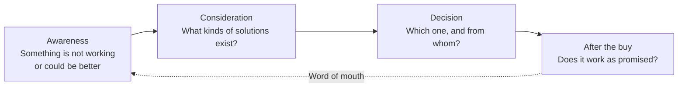

# Sales Essentials
## Module 1: What Selling Is (and Is Not)

**Audience:** Everyone at Resona who talks with people about buying
**Prerequisite:** Resona Foundations
**Lessons:** 1.1 Selling as Helping Someone Decide · 1.2 The Buyer's Journey · 1.3 Trust Is the Real Product · 1.4 Your Role and Its Boundaries
**Who "the customer" is in this course:** Individual decision-makers, mostly small business owners and their staff. Not teams, committees, or enterprise buyers (that is the High Yield Sales course).
**Tone:** Plain language. Honest selling. Fictional examples. Product-neutral.

---

## Lesson 1.1: Selling as Helping Someone Decide

> **Objective**
> By the end of this lesson you can explain what selling is in plain terms, describe how a seller-first conversation differs from a buyer-first one, and say why the buyer's problem comes before the product.

### Chunk 1: A working definition

**Selling** is helping a person decide whether a product or service solves a problem they have.

Three things follow from that definition. The person has a problem or goal, because without one there is nothing to sell. Deciding is their job and not yours, so you inform, ask, and clarify without deciding for them. And "no" is a valid result: if the product doesn't fit, a good conversation ends with a respectful no.

### Chunk 2: Two kinds of conversation

| | **Seller-first** | **Buyer-first** |
|---|---|---|
| **Starts with** | The product and its features | The person's situation and goal |
| **Talks about** | What we offer | What matters to them |
| **Questions are used to** | Steer toward a pitch | Understand the problem |
| **Ends when** | The seller gets a yes or gives up | The person has what they need to decide |
| **How the person feels** | Handled, rushed, or talked at | Heard and in control |

Small business owners are busy, and many don't enjoy being sold to. A 2014 survey by a business-coaching company, covering 401 owners (mostly with fewer than 50 employees), found that 57% said vendor information is "too sales-oriented," and that owners were more influenced by other owners using a product than by the vendor itself. That survey is old, comes from a single self-selected source, and published no method, so it's best read as a hint about attitudes and not as a measurement.

The practical point doesn't depend on any statistic: the less a conversation feels like a pitch, the more the person engages.

### Chunk 3: Why the problem comes first

A product only has value in relation to a problem. Consider two openings with the same business owner, a fictional bakery owner named Dana.

> **Seller-first:** "Hi, I'm with a company that offers a tool with scheduling, reporting, and automated reminders. Let me walk you through the features."
>
> **Buyer-first:** "Hi Dana, I work with small shops like yours. Can I ask what takes up most of your time each week that you wish didn't?"

The first opening hands Dana a list to evaluate, while the second gives her a reason to talk. If Dana's real problem is late supplier orders, a scheduling tool is the wrong answer, and the only way to find that out is to ask.

### Chunk 4: What selling is not

Selling isn't convincing, since having to talk someone into a purchase is a sign that the product may be wrong for that person. It isn't tricking either, because a sale built on a misunderstanding comes back as a refund, a complaint, or a bad review. Strong sellers also spend more time asking and listening than presenting, so selling isn't talking. And it isn't a one-time event: the sale starts a relationship, and the customer's experience afterward is part of the job.

> **Retrieval Practice**
> 1. In your own words, what is selling?
> 2. A seller opens a call by listing features before asking a single question. Which kind of conversation is this, and how is the person on the other end likely to feel?
> 3. Why does the problem come before the product?

> **Takeaway**
> Selling is helping someone decide, which is why the conversation starts with their problem and why a respectful "no" can be the right outcome.

> **When you're working with a customer**
> Before you say anything about the product, ask yourself whether you know what this person is trying to fix or achieve, and if you don't, ask first.

---

## Lesson 1.2: The Buyer's Journey

> **Objective**
> By the end of this lesson you can describe the three common stages of a buying decision, explain what a small business owner needs at each stage, and recognize where a conversation is likely to stall.

### Chunk 1: People do not buy in one step

Before anyone buys, they usually move through stages. A common model has three, and many sales trainers use some version of it.

The model is a simplification. Real journeys involve going back and forth, skipping steps, or stopping altogether, and one sales-software vendor's guide describes them as "winding" and not as a straight funnel. The stages are more useful as a way to ask better questions than as a track the customer must follow.

### Chunk 2: What the person needs at each stage

| Stage | What is going on | What they need | What helps |
|---|---|---|---|
| **Awareness** | They feel a problem or see an opportunity, but may not know their options or whom to trust | To understand the problem and that solutions exist | Clear explanation, credible examples, no pressure |
| **Consideration** | They are comparing kinds of solutions (for example, hire someone, use a tool, or do nothing) and worry about choosing wrong | Help comparing options and the tradeoffs | Honest comparisons, including cases where our product is not the best fit |
| **Decision** | They have a type of solution in mind and are choosing a specific one | Confidence that this choice will work for their situation | Evidence tied to their problem, clear terms, easy next steps |
| **After the buy** | They discover whether it works | Support and follow-through | Prompt help, expectations kept |

The stage names and the "what helps" column follow an article from Close, a sales-software vendor, adapted for this course. The article is vendor content and its supporting statistics haven't been independently verified, so none of them are used here.

### Chunk 3: A small business owner's version

Small business owners tend to decide alone or with one other person, such as a partner or key employee, so the journey can be fast. They wear many hats, which makes time the scarce resource, and they weigh cash carefully because a purchase may come from money they feel directly. Other owners are a strong influence on them, so referrals and reviews matter; the 2014 survey mentioned earlier found peers were the most-cited influence. Finally, they need a purchase to work on day one, since they usually have no one to troubleshoot for them.

All of this is why a short, clear, honest conversation tends to beat a long pitch.

### Chunk 4: Where conversations stall

| Sign | Likely stage problem | What to try |
|---|---|---|
| "I'm not sure we need this" | Awareness: the problem is not felt yet | Ask about their current situation instead of pitching more |
| "I'm looking at a few options" | Consideration: comparing | Offer an honest comparison and the questions they should ask any seller |
| "I need to think about it" | Decision: unresolved worry | Ask what they would want to be sure about |
| "Sounds good" followed by silence | Interest without commitment | Agree on a specific next step |
| "It's not what I expected" | After the buy: expectations missed | Listen, fix what you can, and learn from it |

### Chunk 5: You do not control the journey

You can't speed up someone's thinking. What you can do is make each stage easier by being clear, honest, and available, and by not pushing the person past where they are.

> **Retrieval Practice**
> 1. Name the three stages before a purchase.
> 2. A business owner says, "I'm looking at a few options." Which stage are they in, and what do they need most from you?
> 3. Why is the model a simplification and not a rule?

> **Takeaway**
> People move through awareness, consideration, and decision at their own pace, so the useful question is which stage this person is in and what would help them at that point.

> **When you're working with a customer**
> If you can't tell which stage a person is in, ask a question that would reveal it, such as "How long has this been on your mind?"

---

## Lesson 1.3: Trust Is the Real Product

> **Objective**
> By the end of this lesson you can describe four ingredients of trust, say which one salespeople most often get wrong, and list everyday habits that build or erode it.

### Chunk 1: Why trust comes first

Customers can't fully inspect a product before buying, so they rely on whether they trust the person and the company behind it. A small business owner who has been burned before is especially careful.

Trust is built from what you do and not from what you say about yourself. It builds slowly and can break quickly.

### Chunk 2: The Trust Equation

The authors of a well-known book on advisors proposed a simple model called the **Trust Equation**. It's a practitioner framework and not peer-reviewed research, and the firm that publishes it sells training, so it works best as a checklist.

**Trust = (Credibility + Reliability + Intimacy) ÷ Self-Orientation**

| Ingredient | In plain words | In a sales conversation |
|---|---|---|
| **Credibility** | Do I believe what you say, and do you know your subject? | Accurate, specific answers; saying "I don't know, let me find out" |
| **Reliability** | Do you do what you say you will? | Showing up on time, sending what you promised, returning calls |
| **Intimacy** | Is it safe to tell you something sensitive? | Keeping confidences; not repeating what you hear to others |
| **Self-Orientation** | Whose interests are you focused on, theirs or yours? | The one that lowers trust the most when it is high |

The same source argues that self-orientation is the factor that most often undermines sellers. Because it sits in the denominator, a high number shrinks everything else: a person can sound credible, show up on time, and keep confidences, yet if the customer senses that you care mostly about your commission, trust drops.

### Chunk 3: Signs of high and low self-orientation

| Looks like high self-orientation | Looks like low self-orientation |
|---|---|
| Steering every topic back to the product | Following the customer's concerns, even when they point away from a sale |
| Checking the clock or phone | Full attention |
| Interrupting | Letting them finish |
| Pushing past a hesitation | Asking what the hesitation is |
| Talking about your goals ("I'm trying to hit my number") | Talking about theirs |
| Exaggerating to close | Admitting limits |

### Chunk 4: Small habits that build trust

A handful of small habits do most of the work. Being early, or at least on time, shows respect, and if you're going to be late, saying so before it happens keeps the habit intact. Doing what you said you would do, by when you said you would do it, is the core of reliability, and putting promises in writing (an email or a text) means both people remember the same thing. Saying "I don't know" and then finding out builds credibility, and admitting mistakes quickly and fixing them does the same. Respecting a "no" without a guilt trip, and keeping private what you hear, including what one customer tells you about their business, complete the list.

### Chunk 5: Things that erode trust fast

Several behaviors damage trust quickly: overstating what the product does, hiding costs, terms, or limits, and speaking badly about competitors. Fake urgency ("this price ends tonight") when it isn't true has the same effect, as does contacting someone again and again after they said no, or making a promise you can't keep, even a small one.

> **Retrieval Practice**
> 1. Name the four ingredients in the Trust Equation.
> 2. Which one is in the denominator, and what does that mean for the other three?
> 3. A rep sounds knowledgeable and is always on time, but keeps steering the conversation to their quota. Which ingredient is hurting trust?

> **Takeaway**
> Customers buy from people they trust, and because self-orientation divides the other three ingredients, focusing on yourself can undo credibility, reliability, and discretion at once.

> **When you're working with a customer**
> Before you leave a conversation, check what you promised, whether it's written down, and when you'll do it, and then do it early.

---

## Lesson 1.4: Your Role and Its Boundaries

> **Objective**
> By the end of this lesson you can state what you do and do not do in a sales conversation, list common pressure tactics to avoid and why, and describe when to escalate.

### Chunk 1: Your role

In a sales conversation you are a guide and a source of accurate information. You ask questions to understand the person's situation, explain what the product does and doesn't do in plain language, and show how it would fit their situation with honest evidence. You answer concerns truthfully, offer clear next steps and let the person decide, and follow through on every commitment.

### Chunk 2: What you never do

These are firm rules, and they are worded without exceptions.

- **Overstate.** Do not claim results, features, or savings that are not true and provable.
- **Hide.** Do not leave out costs, terms, limits, or conditions the customer would want to know.
- **Pressure.** Do not use the tactics listed below.
- **Promise outcomes.** No one can guarantee how a customer's business will do.
- **Give advice you are not qualified to give.** Legal, tax, financial, and accounting questions go to the customer's own professionals.
- **Misuse what you learn.** What a customer tells you about their business stays confidential.
- **Make commitments outside your authority.** Pricing is set in advance as a subscription plan, so you do not negotiate, invent, or promise a different price. You offer the published plans and any official promotions, and nothing else. Custom terms, special promises, and any request outside the published plans go to the right person at Resona.

### Chunk 3: Pressure tactics to avoid

A sales-software vendor's article lists tactics it calls high-pressure. The list comes from a vendor blog and reflects that company's view, but the tactics are widely recognized as harmful to trust.

| Tactic | Why it backfires |
|---|---|
| **Fake or tight deadlines** ("price ends today") | Feels manipulative, and can be deceptive if the deadline is not real |
| **"Act now or miss out" language** | Rushes a decision the person is not ready to make |
| **Excessive contact** (repeated calls, texts, or emails) | Reads as desperate and can lead people to block you |
| **Irrelevant add-ons** | Signals you care about the total, not their need |
| **Attacking competitors** | Sounds petty, and false statements can create legal risk |
| **Ignoring a clear "no"** | Ends the relationship and harms reputation |
| **Guilt or passive-aggressive remarks** | Damages trust immediately |
| **Making it hard to cancel or opt out** | Turns a customer into an angry critic |

The source is a 2023 Close blog post, updated in 2026. It also cites several statistics with no published methods, and those are not used here.

A simple test applies to all of these: would you be comfortable if the customer could see exactly what you were thinking and why you said it? If the answer is no, don't do it.

### Chunk 4: When you are unsure

When you're unsure, stop and ask. There are several good moments to escalate: when the customer asks for something outside what you can offer, when a claim or promise is requested that you can't verify, or when the customer seems confused, upset, or vulnerable. The same goes for any legal, billing, or safety concern from a customer, and for any time you think you made a mistake.

A reply such as "That's a good question. Let me check and get back to you by Thursday" keeps the conversation honest, as long as you then do exactly that.

### Chunk 5: Why the boundaries help you

Staying in role protects you as much as the customer. When claims are true and provable, customers stay, refunds drop, and referrals come. Avoiding pressure means people return your calls, escalating what is beyond you keeps problems small, and keeping confidences leads owners to tell you what they really need.

Small business owners talk to each other, so a reputation for being straight with people travels and helps every conversation afterward.

### Chunk 6: Glossary for this module

| Term | Meaning |
|---|---|
| **Selling** | The work of helping a person decide whether a product or service solves a problem they have |
| **Seller-first** | A kind of conversation that starts with the product and the seller's goals |
| **Buyer-first** | A kind of conversation that starts with the person's situation and goal |
| **Buyer's journey** | The set of stages a person moves through before and after a purchase |
| **Awareness** | The stage in which a person recognizes a problem or opportunity |
| **Consideration** | The stage in which a person compares kinds of solutions |
| **Decision** | The stage in which a person chooses a specific option |
| **Trust Equation** | A practitioner framework that expresses trust as credibility plus reliability plus intimacy, divided by self-orientation |
| **Self-orientation** | The degree to which a person focuses on their own interests instead of the customer's |
| **High-pressure tactic** | A technique that rushes or pushes a person past their own judgment |
| **Escalate** | To bring a question or concern to the right person instead of guessing |
| **Provable claim** | A statement about a product or result that can be shown to be true |

> **Retrieval Practice**
> 1. Name three things you never do in a sales conversation.
> 2. A customer asks whether the product will double their revenue, and you can't know. What do you say?
> 3. Why is a fake deadline harmful?

> **Takeaway**
> You are a guide and a source of accurate information, which is why staying truthful, avoiding pressure, keeping promises, and escalating what is beyond you protect both the customer and your own reputation.

> **When you're working with a customer**
> Keep a short note of every promise you make and when it's due, and check it before every follow-up.

---

## Module 1 Mastery Check

*Locked until all four lessons are complete. Suggested pass mark: 80%.*

**Q1.** Which best describes selling in this course?
- A. Convincing people to buy once they've heard the full pitch
- **B. Helping a person decide whether a product solves a problem they have** (correct)
- C. Presenting every feature so the buyer has complete information
- D. Closing as quickly as possible while interest is high

**Q2.** A seller opens with a list of product features before asking anything. Which approach is this?
- A. Buyer-first, because the buyer hears the full picture
- B. Consultative, because the seller is offering expertise
- **C. Seller-first** (correct)
- D. After-the-buy, because the seller is describing what the product does

**Q3.** A business owner says, "I'm looking at a few options." Which stage are they most likely in, and what helps most?
- **A. Consideration; an honest comparison and the questions they should ask any seller** (correct)
- B. Awareness; a long product demo to explain the problem
- C. Decision; a deadline that encourages them to act
- D. After the buy; a quick refund to remove any doubt

**Q4.** In the Trust Equation, which ingredient lowers trust when it is high?
- A. Credibility
- B. Reliability
- C. Intimacy
- **D. Self-orientation** (correct)

**Q5.** A customer asks, "Will this double my revenue?" You cannot know. What is the best response?
- A. "Absolutely, that's what most of our customers see."
- B. "Most customers do, so I'd expect you to as well."
- C. "Don't worry about that, it's a small risk."
- **D. "I can't promise results, but I can show you what I know and what other owners have reported." (Only if true and provable.)** (correct)

**Q6.** Which is a high-pressure tactic to avoid?
- A. Following up once, as promised
- **B. Telling someone a price "ends tonight" when it does not** (correct)
- C. Explaining an actual end date for an offer
- D. Asking what is on their mind

**Q7.** A customer asks a tax question about how the purchase will be treated. What do you do?
- A. Give your best guess, since you've seen similar cases
- B. Say it's always deductible, to keep things simple
- C. Change the subject to the product's features
- **D. Suggest they ask their own accountant, and stay within what you can state accurately about the product** (correct)

**Q8.** You promised to send information by Friday and cannot. What is the best approach?
- A. Send it next week without comment
- B. Hope the customer has forgotten about it
- **C. Tell the customer before Friday, give a new date, and keep it** (correct)
- D. Cancel the follow-up so no date is missed

---

### Author's notes (remove before publishing)

- **Source basis and limits.**
  - **Lesson 1.1's "buyer-first" vs. "seller-first" framing** is my teaching device, informed by widely taught consultative-selling practice. It is not from a single source. The bakery example is fictional.
  - **The survey in 1.1 and 1.2** is a 2014 "Small Business Pulse Survey" by The Alternative Board, a franchised business-coaching company, covering 401 owners, mostly from the US, Canada, the UK, New Zealand and Ireland. The page reports percentages without sampling method, question wording, or margins of error, and the data is over a decade old. **I used only two points (owners find vendor information too sales-oriented; peers are the most-cited influence) and labeled them as hints about attitudes.** If you want current numbers, we should find a newer independent survey.
  - **Lesson 1.2's journey stages** follow a Close (CRM vendor) article, last updated May 2026. It is vendor marketing and relies on a Demand Gen Report survey and other figures I did not verify, so **I used the stage model and the seller actions only, not the statistics.** The note that journeys are winding rather than linear is from the same article.
  - **The "small business owner's version" in 1.2** is my synthesis for this audience, supported only loosely by the survey. It reflects general experience, not a specific study. **Please correct it with what you see in the field.**
  - **The Trust Equation in 1.3** is from Trusted Advisor Associates (the framework comes from *The Trusted Advisor*, 2000, and *Trust-based Selling*, 2006). It is a consulting firm's practitioner model, not peer-reviewed research. The firm sells training based on it. The lesson says so and uses it as a checklist. The "high vs. low self-orientation" table is my own illustration.
  - **The pressure-tactics list in 1.4** follows a Close blog post (2023, updated 2026). Close is a CRM vendor. The post cites several statistics with no methods (discount-seeking, upsell rates, follow-up cadence), which I left out. The "why it backfires" column is largely my own reasoning. The "false deadline can be deceptive" point is a general consumer-protection principle I have not researched in depth. **Consumer protection and contact rules get proper treatment in Modules 7 and 8, with legal review flagged there.**
- **No product, price, or internal-playbook content** appears in this module, so the content gate is not in play here.
- **Pricing (resolved):** you confirmed pricing is pre-determined because the product is a subscription. Lesson 1.4 now says reps do not negotiate or invent prices and offer only published plans and official promotions. **Still open:** the lesson says non-standard requests go to "the right person at Resona." If you want a named role, tell me and I will add it.
- **B2C framing.** Per your direction, "customer" means small business owners and staff deciding on their own. Teams and enterprise buyers belong to High Yield Sales (B2B).
- The glossary maps onto `glossary_terms` for flashcards. The Mermaid diagram in 1.2 uses ` ` line breaks, which some renderers do not support. The CLI cleanup can simplify it if needed.
- **Style pass.** The first-person source caveats that appeared in the lesson body were rewritten as plain attributions. Inline module cross-references were removed from the body text. The "what you never do" list and the pressure-tactics table were kept as firm lists, because they are behavior rules.

### Sources

- [Trusted Advisor Associates: Trust in Business: The Core Concepts (Trust Equation)](https://trustedadvisor.com/articles/trust-in-business-the-core-concepts)
- [The Alternative Board: How Business Owners Make Buying Decisions (2014 survey; coaching company)](https://www.thealternativeboard.com/how-business-owners-make-buying-decisions)
- [Close: What's the Buyer's Journey? And How It's Changed Over Time (CRM vendor)](https://close.com/blog/are-buyers-liars)
- [Close: 7+ High-Pressure Sales Tactics to Avoid (CRM vendor)](https://close.com/blog/high-pressure-sales-tactics)
